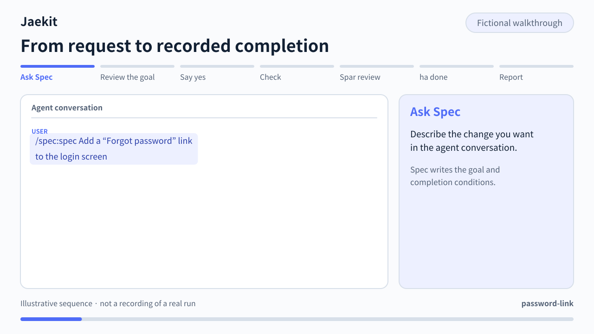
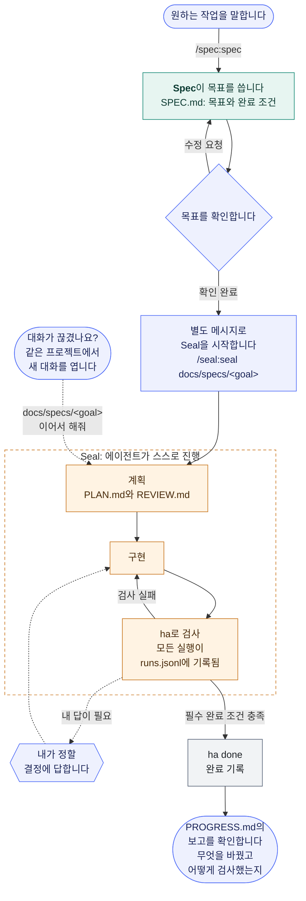
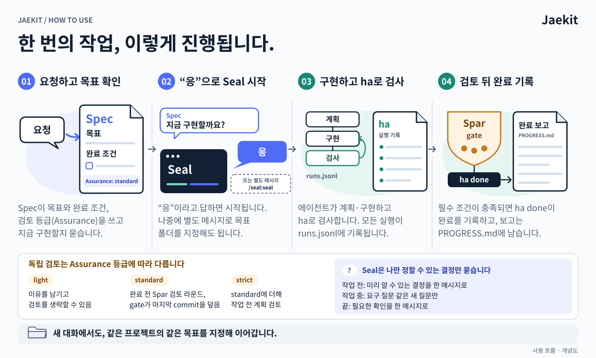
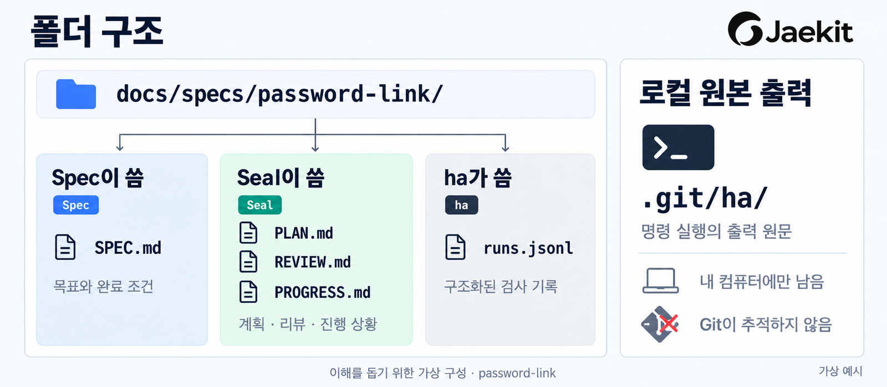
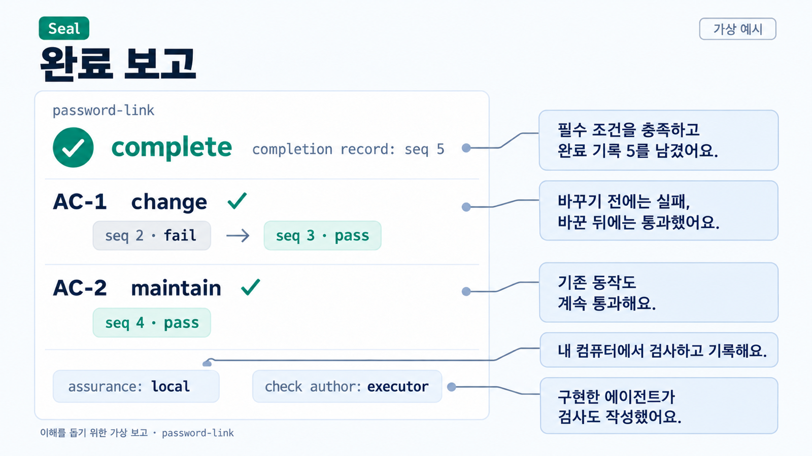

<p align="center">
  
</p>

<p align="center">
  <a href="https://github.com/jgoneit/jaekit/releases"></a>
  <a href="guides/INSTALL.md"></a>
  <a href="guides/INSTALL.md#기본-설치"></a>
  <a href="LICENSE"></a>
</p>

<p align="center"><a href="README.md">English</a> · <strong>한국어</strong><br /><a href="#설치">설치</a> · <a href="#첫-작업-맡기기">첫 작업</a> · <a href="#업데이트">업데이트</a> · <a href="#남는-문서와-기록">남는 기록</a> · <a href="guides/USAGE.md">사용 안내</a></p>

Jaekit은 **Codex·Claude Code에 맡긴 작업을 목표부터 완료 기록까지 이어 주는 도구**입니다.

- **Spec**은 원하는 일을 목표 문서와 완료 조건으로 정리합니다.
- **Seal**은 에이전트가 그 목표대로 구현·검사·수정하게 하고, 검사 기록으로 완료를 판단합니다.

현재 배포판은 **v0.1.6**입니다. 실제 작업에 써 보며 다듬는 초기 개발 단계입니다.

## 이럴 때 좋습니다

- **"다 했습니다"를 기록으로 확인하고 싶을 때**<br>
  필수 완료 조건이 검사 기록이나 필요한 사용자 확인으로 충족돼야 완료가 남습니다. 무엇을 바꿨고 어떻게 검사했는지는 완료 보고에서 봅니다.
- **대화가 끊겨도 이어 가고 싶을 때**<br>
  목표·계획·진행 기록이 프로젝트 폴더에 남습니다. 새 대화에서 같은 목표를 지정하면 저장된 지점부터 이어 갑니다.
- **단계마다 승인하지 않고 맡기고 싶을 때**<br>
  에이전트가 계획·구현·검사를 이어서 진행합니다. 결과를 바꾸는 결정이나 직접 확인이 필요할 때 묻습니다.
- **구현 전에 요청부터 정리하고 싶을 때**<br>
  Spec만 따로 쓸 수 있습니다. 목표와 완료 조건을 문서로 남겨 두고, 준비됐을 때 Seal을 시작합니다.

## 사용 흐름



영어 화면으로 만든 가상 장면이며 실제 실행을 녹화한 것이 아닙니다. 아래 다이어그램은 단계마다 누가 무엇을 하는지 보여 줍니다.



1. Spec은 목표 문서를 작성한 뒤 **멈춥니다**. 내용을 읽고 고칠 점을 말합니다.
2. 확인이 끝나면 **별도 메시지로 Seal을 시작**합니다. 에이전트가 구현·검사·수정을 진행합니다.
3. 필수 완료 조건이 충족되면 완료 기록과 보고가 남습니다. **무엇을 바꿨고 어떻게 검사했는지** 실제 결과와 함께 확인하세요.

<details>
<summary>같은 흐름을 그림으로 보기</summary>



</details>

## 시작하기

### 준비물

- **Git**과 **Git으로 관리하는 작업 프로젝트 폴더.** Jaekit 저장소를 clone할 필요는 없습니다.
- **Claude Code** 또는 **[Codex CLI](https://learn.chatgpt.com/docs/codex/cli)**
- macOS·Linux에서는 **[Homebrew](https://brew.sh)**(프로그램 설치 도구)를 권장합니다. 없으면 Release 파일로 설치합니다.

### 설치

먼저 내 환경에서 무엇을 쓸 수 있는지 확인합니다.

| 환경 | Spec | Seal | 설치 방법 |
| --- | --- | --- | --- |
| macOS (Apple Silicon·Intel) | 사용 | 사용 | 아래 Homebrew 명령 |
| Linux (arm64·amd64) | 사용 | 사용 | Homebrew가 있으면 아래 명령, 없으면 [Release 파일로 설치](guides/INSTALL.md#release-파일로-설치) |
| Windows의 WSL2 (Ubuntu 24.04 x64) | 준비됨·실사용 미확인 | 준비됨·실사용 미확인 | [WSL2 준비 안내](guides/WSL.md)를 따라 Release 파일로 설치 |
| Windows (네이티브) | 미확인 | 사용 불가 | 아직 공개 설치 파일 없음 |

에이전트별 지원도 확인합니다.

| 에이전트 | Spec | Seal | 호출 |
| --- | --- | --- | --- |
| Claude Code | 사용 | 사용 | `/spec:spec`, `/seal:seal` |
| Codex (CLI·데스크톱 앱) | 사용 | 사용 | `$spec:spec`, `$seal:seal` |

<details>
<summary><strong>Windows 사용자</strong>: 지금 쓸 수 있는 것</summary>

- 현재 공개 릴리스에서 네이티브 Windows는 기록 도구 `ha`가 지원되지 않아 Seal을 쓸 수 없습니다. 이 제한은 네이티브 실행에 관한 것입니다.
- Spec은 `ha`가 필요 없지만, Windows에서의 설치와 동작은 아직 확인하지 않았습니다.
- WSL2의 Ubuntu 24.04 LTS x64에서는 Linux용 Release 파일로 설치합니다. Homebrew는 필요하지 않습니다. 실제 WSL2 설치와 에이전트 사용은 아직 확인하지 않았습니다. → [WSL2 준비 안내](guides/WSL.md)
- 네이티브 Windows(Windows 11 x64, PowerShell 5.1·7)는 개발 중인 후보만 있고, 실제 실행은 확인 전입니다. → [Windows 네이티브 후보 안내](guides/WINDOWS.md)

</details>

#### 1. 터미널에서 기록 도구 `ha` 설치하기

블록은 하나씩 실행하고, 끝날 때까지 기다립니다.

```bash
brew install jgoneit/tap/jaekit
```

```bash
ha --version
which -a ha
```

`ha 0.1.6`이 나오면 됩니다. `which -a ha`의 첫 줄이 실제로 실행되는 파일입니다. 명령을 찾지 못하거나 버전이 다르면 [버전 확인](guides/INSTALL.md#버전-확인)을 봅니다.

Homebrew 없이 설치하려면 이 단계 대신 [Release 파일로 설치](guides/INSTALL.md#release-파일로-설치)의 블록을 붙여 넣습니다. OS와 CPU에 맞는 파일을 받아 checksum을 확인한 뒤 `~/.local/bin/ha`에 둡니다. 다른 설치 방법과 자세한 설명은 [설치 안내](guides/INSTALL.md)에 있습니다.

#### 2. 에이전트 플러그인 설치하기

같은 터미널에서 쓰는 쪽 블록만 실행합니다.

이미 설치했다면 아래 [업데이트](#업데이트)를 따릅니다. 저장소 checkout 경로로 등록해 쓰던 경우에는 [로컬 경로 등록에서 옮기기](guides/INSTALL.md#로컬-경로-등록에서-옮기기)를 먼저 봅니다.

**Claude Code**

```bash
claude plugin marketplace add jgoneit/jaekit#v0.1.6
claude plugin install spec@jaekit
claude plugin install seal@jaekit
claude plugin list
```

> [!TIP]
> 설치 후 **Claude Code를 새로 엽니다.** 마지막 목록에 `spec@jaekit`, `seal@jaekit`가 enabled로 보이면 됩니다. `#v0.1.6`은 사용할 배포판을 고정합니다. 자세한 내용은 [Claude Code 설치](guides/INSTALL.md#claude-code)를 봅니다.

**Codex**

```bash
codex plugin marketplace add jgoneit/jaekit@v0.1.6
codex plugin add spec@jaekit
codex plugin add seal@jaekit
```

> [!TIP]
> 설치 후 **Codex를 새로 엽니다.** `@v0.1.6`은 사용할 배포판을 고정합니다.

### 첫 작업 맡기기

작업할 프로젝트 폴더에서 Claude Code 또는 Codex(CLI·데스크톱 앱)를 엽니다.

> [!IMPORTANT]
> 이제부터는 터미널이 아니라 에이전트 대화에 입력합니다.

#### 1. Spec에 요청하기

사용하는 에이전트에 맞는 예시로 원하는 작업을 적습니다.

**Claude Code**

```text
/spec:spec 로그인 화면에 "비밀번호 찾기" 링크를 추가해줘
```

**Codex** — `$`를 입력하고 목록에서 Jaekit의 `spec:spec`을 고릅니다.

```text
$spec:spec 로그인 화면에 "비밀번호 찾기" 링크를 추가해줘
```

> [!NOTE]
> 위 요청은 재설정 페이지가 이미 있는 프로젝트를 가정한 **가상 예시**이며, 실행하거나 검증을 마친 사례가 아닙니다. 실제 프로젝트에서 원하는 작업으로 바꿔 보내세요.

#### 2. 목표 확인하기

Spec이 알려 준 문서를 읽고 고칠 내용을 말합니다.

이 예시라면 “새 링크가 기존 재설정 페이지로 연결되는지”, “기존 로그인이 그대로 동작하는지”가 완료 조건입니다.

#### 3. 별도 메시지로 Seal 시작하기

목표 폴더를 지정합니다.

**Claude Code**

```text
/seal:seal docs/specs/<goal>
```

**Codex** — `$` 목록에서 Jaekit의 `seal:seal`을 고릅니다.

```text
$seal:seal docs/specs/<goal>
```

> [!TIP]
> `<goal>`은 **Spec이 알려 준 실제 목표 폴더 이름으로 바꾸는 자리**입니다. 이름이 `password-link`라면 전체 경로는 `docs/specs/password-link`입니다.

자세한 호출 방법은 [사용 안내](guides/USAGE.md#명령-보내기)를 참고하세요.

### 대화가 끊겼다면

**같은 프로젝트 폴더에서 새 대화**를 열고, 이전에 작업한 목표를 지정합니다.

```text
docs/specs/<goal> 이어서 해줘
```

`<goal>`을 실제 폴더 이름으로 바꾸면 저장된 목표와 진행 기록에서 이어 갑니다.

### 업데이트

> [!WARNING]
> 새 배포판이 나오면 `ha`와 두 플러그인을 **함께** 올립니다. 버전이 섞이면 Seal이 기록하기 전에 멈출 수 있습니다.

#### 1. `ha` 올리기

Homebrew로 설치했다면 아래 두 블록을 차례로 실행합니다.

```bash
brew update
```

```bash
brew upgrade jgoneit/tap/jaekit
```

Release 파일로 설치했다면 [Release 파일로 설치](guides/INSTALL.md#release-파일로-설치)의 블록을 다시 붙여 넣습니다.

#### 2. 실제로 실행되는 `ha` 확인하기

```bash
ha --version
which -a ha
```

새 버전이 나오지 않으면 `which -a ha`의 첫 줄을 봅니다. 그 파일이 실제로 실행됩니다.

Homebrew와 Release 파일로 둘 다 설치했다면, 쓰지 않는 쪽을 지우거나 같은 버전으로 올립니다. 한쪽만 올리면 앞선 쪽의 옛 버전이 계속 실행될 수 있습니다.

#### 3. 플러그인을 새 배포판으로 다시 등록하기

marketplace를 지우면 그 안의 spec·seal도 함께 지워지므로 다시 설치합니다.

**Claude Code**

```bash
claude plugin marketplace remove jaekit
claude plugin marketplace add jgoneit/jaekit#v0.1.6
claude plugin install spec@jaekit
claude plugin install seal@jaekit
```

**Codex**

```bash
codex plugin marketplace remove jaekit
codex plugin marketplace add jgoneit/jaekit@v0.1.6
codex plugin add spec@jaekit
codex plugin add seal@jaekit
```

#### 4. Claude Code·Codex 다시 열기

새 Spec·Seal은 새로 연 세션부터 쓰입니다.

업데이트는 목표 문서와 실행 기록을 지우지 않습니다. 이전 버전 자료 정리와 제거는 [업데이트](guides/INSTALL.md#업데이트)·[제거](guides/INSTALL.md#제거)를 봅니다.

## 남는 문서와 기록

Jaekit이 쓰는 내용은 모두 프로젝트 안, 목표마다 하나인 폴더에 남습니다. 아래 예시는 **줄인 가상 예시**로 형식을 보여 줄 뿐, 실제 작업 기록이 아닙니다. `## Acceptance Criteria`, `## 조건표`, `AC-1` 같은 제목과 표지는 형식 토큰이라 그대로 두고, 설명 문장은 사용자의 언어로 씁니다.



<details>
<summary>같은 폴더를 글로 보기</summary>

```text
docs/specs/password-link/
├── SPEC.md        목표, 사용 시나리오, 완료 조건              ← Spec
├── PLAN.md        조건별 검사 방법, 범위, 예산                ← Seal
├── REVIEW.md      작업 시작 전 계획 검토                      ← Seal
├── PROGRESS.md    현재 상태, 타임라인, 완료 보고              ← Seal
└── runs.jsonl     덧붙이기만 하는 실행 기록                   ← ha만 씀

.git/ha/           검사 출력 원문. Git이 추적하지 않으며 ha log로 봅니다
```

</details>

### 완료 보고



필수 완료 조건이 충족되면 Seal이 `ha done`을 실행하고, 그 출력을 고치지 않고 `PROGRESS.md`의 `## 완료 보고`에 붙인 뒤 자기 설명을 덧붙입니다. `ha` 출력의 설명 문장은 언어와 관계없이 영어입니다. GitHub에서는 이렇게 보입니다.

> **ha status: docs/specs/password-link**
>
> - status: **complete** (exit 0)
> - completion record: seq 5
> - assurance: local (an agent with the same user permissions can change checks and records)
> - check author: executor
> - rules: run-rules/4; skill: seal 0.1.17 (claimed); ha: 0.1.6
>
> | ID | kind | required | satisfied | reason | records | attempts |
> | --- | --- | --- | --- | --- | --- | --- |
> | AC-1 | change | yes | yes | — | 2, 3 | checks 1 (fail 0, error 0), baselines 1 (unexpected pass 0, error 0), stale 0 |
> | AC-2 | maintain | yes | yes | — | 4 | checks 1 (fail 0, error 0), baselines 0 (unexpected pass 0, error 0), stale 0 |
>
> - 완료 범위: 완료 기록 seq 5의 commit aa4bd917b591이 올릴 head와 같습니다.
> - 바꾼 파일(에이전트의 주장): src/login.html — AC-1
> - 남은 한계: 보증 수준 local, 검사는 에이전트가 작성, manual 조건 없음

<details>
<summary><code>PROGRESS.md</code>의 Markdown 원문 보기</summary>

```markdown
## 완료 보고

## ha status: docs/specs/password-link

- status: **complete** (exit 0)
- completion record: seq 5
- assurance: local (an agent with the same user permissions can change checks and records)
- check author: executor
- record head: seq 5 (315888484b42)
- rules: run-rules/4; skill: seal 0.1.17 (claimed); ha: 0.1.6
- code: aa4bd917b591, tree clean: yes; goal digest: f1f24cc156b0
- attempts: 3 total; types: 2 check, 1 baseline; outcomes: 0 environment errors, 0 unknown; inputs: 3 current, 0 stale; valid positive evidence: 3 (overlapping axes)

### Criteria

| ID | kind | required | satisfied | reason | records | attempts |
| --- | --- | --- | --- | --- | --- | --- |
| AC-1 | change | yes | yes | — | 2, 3 | checks 1 (fail 0, error 0), baselines 1 (unexpected pass 0, error 0), stale 0 |
| AC-2 | maintain | yes | yes | — | 4 | checks 1 (fail 0, error 0), baselines 0 (unexpected pass 0, error 0), stale 0 |

### Reasons

None.

- 완료 범위: 완료 기록 seq 5의 commit aa4bd917b591이 올릴 head와 같습니다.
- 바꾼 파일(에이전트의 주장): src/login.html — AC-1
- 남은 한계: 보증 수준 local, 검사는 에이전트가 작성, manual 조건 없음
```

</details>

읽는 법:

- **status**는 `ha`가 실행 기록·Git·목표 문서로 계산한 값이며, 에이전트의 주장이 아닙니다. completion record에 seq가 있으면 `ha done`이 완료를 기록했다는 뜻입니다.
- **records**는 `runs.jsonl`의 줄 번호(seq)입니다. AC-1의 seq 2는 시작 commit에서 돌린 검사가 선언대로 실패한 기록이고, seq 3은 같은 검사가 결과에서 통과한 기록입니다.
- 실행의 출력 원문은 `.git/ha/`에 남습니다. 터미널에서 `ha log docs/specs/password-link 3`으로 봅니다.

> [!IMPORTANT]
> **assurance: local**과 **check author: executor**는 에이전트가 내 컴퓨터에서 검사를 작성하고 실행했다는 뜻입니다. 독립된 제3자의 검증이 아니므로 바뀐 검사와 실제 결과도 함께 확인합니다.

완료 전에 작업이 멈추면 보고에는 대신 `ha status`가 들어가고, 무엇이 부족한지 `### Unmet` 목록으로 보입니다.

```text
- status: **incomplete** (exit 1)

### Unmet

- AC-2 `criterion_failed` (executor): seq 4, output `ha log docs/specs/password-link 4`
```

### 다른 파일

<details>
<summary><strong>SPEC.md</strong>: 원하는 일을 검사할 수 있는 조건으로</summary>

```markdown
# 비밀번호 찾기 링크

Status: Ready
Criteria-Format: nested/1

## 목표

로그인 화면에 기존 재설정 페이지로 가는 "비밀번호 찾기" 링크를 추가한다.

## 사용 시나리오

비밀번호를 잊은 사용자가 링크를 눌러 재설정 페이지로 간다(AC-1).
기존 로그인은 그대로 동작한다(AC-2).

## Acceptance Criteria
- **AC-1** 로그인 화면에 `/reset-password`로 가는 "비밀번호 찾기" 링크가 보인다.
- **AC-2** 기존 로그인 폼이 그대로 동작한다.

## Open Decisions

없음
```

`Status: Ready`는 결과를 바꾸는 결정이 남지 않았다는 뜻입니다. Spec은 여기서 멈추며, Seal을 시작하기 전에는 아무것도 구현하지 않습니다.

</details>

<details>
<summary><strong>PLAN.md</strong>: 조건마다 Seal이 검사하는 방법</summary>

```markdown
## 조건표
| ID | 종류 | 검증 명령 | 검사 경로 | Task |
| --- | --- | --- | --- | --- |
| AC-1 | change | `python3 checks/login_link.py` | checks/login_link.py, checks/login-link.json | T001 |
| AC-2 | maintain | `python3 -m unittest tests.test_login` | — | T001 |

## 결과 계약
| ID | 선언 경로 |
| --- | --- |
| AC-1 | checks/login-link.json |
```

- `change`는 새 동작입니다. Seal은 같은 검사를 시작 commit에서도 돌려 선언대로 실패하는지 보고, 결과에서는 통과해야 합니다.
- `maintain`은 계속 동작해야 하는 기존 동작이고, `manual`은 사용자만 확인할 수 있는 조건입니다.
- 계획에는 Seal이 바꿀 수 있는 경로, task, 실행 예산도 들어갑니다. `REVIEW.md`는 작업 시작 전에 이 계획을 검토한 기록입니다.

</details>

<details>
<summary><strong>runs.jsonl</strong>: 보고 뒤에 있는 실행 기록</summary>

`ha`는 기록하는 사건마다 JSON 한 줄을 덧붙입니다. `start`, 실행한 대상마다 한 줄인 `check`·`baseline`(`ha check <goal> AC-1 AC-2`는 두 줄), `note`(인용한 사용자 확인과 답), `budget_change`, `done`, 완료 뒤 기록한 발견의 `finding`이 있습니다. 각 줄은 앞 줄의 해시(`prev`)를 담아서, 앞선 줄을 고치거나 지우면 연결이 끊기고 `ha`가 `record_integrity`로 알립니다. 마지막 줄은 뒤에 이어지는 줄이 없어 바뀌어도 드러나지 않습니다. 완료 보고의 record head(seq와 해시)는 `ha done`을 실행한 때의 마지막 줄이며, 그 뒤에 note나 finding 같은 줄이 더 붙을 수 있습니다. 줄인 `done` 줄 예시입니다.

```text
{"schema":"run/v1","seq":5,"prev":"a22dbbfe…","kind":"done","status":"complete","commit":"aa4bd917…","tree_clean":true,"criteria":[{"id":"AC-1","kind":"change","satisfied":true,"records":[2,3]},{"id":"AC-2","kind":"maintain","satisfied":true,"records":[4]}]}
```

</details>

더 보기: [완료 보고 읽기](guides/USAGE.md#완료-보고-읽기) · [저장되는 파일](guides/USAGE.md#저장되는-파일) · [문서 형식 예시](examples/README.md)

## 쓰기 전에 알아두면 좋은 점

<details>
<summary><strong>완료 보고에서는 무엇을 확인하나요?</strong></summary>

필수 완료 조건은 검사 기록 또는 필요한 사용자 확인으로 충족돼야 합니다.

자동 검사는 에이전트가 작성하므로, 완료가 결과 전체의 무결함이나 독립된 제3자의 검증을 보장하지는 않습니다. 보고의 가정·남은 한계와 실제 결과를 함께 확인합니다.

기본 작업 결과는 로컬 변경과 commit(변경 이력 저장)까지입니다. GitHub에 올리거나 PR을 만들고 배포하는 일은 직접 하거나 일반 에이전트에 별도로 요청합니다. [완료 보고 읽기](guides/USAGE.md#완료-보고-읽기)

</details>

<details>
<summary><strong>목표만 정리해도 되나요?</strong></summary>

네. Spec은 Seal·`ha` 없이 사용할 수 있습니다. 목표를 정리해 두고 구현할 준비가 됐을 때 Seal을 시작하세요.

</details>

<details>
<summary><strong>어떤 기록이 남나요?</strong></summary>

프로젝트에 목표 문서, 작업 계획, 진행·완료 보고와 실행 기록이 남습니다. 진행 보고는 목표 폴더의 `PROGRESS.md`에서 볼 수 있습니다. 예시는 [남는 문서와 기록](#남는-문서와-기록)에 있습니다.

설치·업데이트·제거는 이 기록을 지우지 않습니다. Git 추적은 프로젝트 정책을 따르며, 공개 전에는 내용을 확인합니다. [저장되는 파일](guides/USAGE.md#저장되는-파일)

</details>

## 더 알아보기

- [설치·업데이트·제거](guides/INSTALL.md) · [배포판과 호환 범위](guides/INSTALL.md#배포판과-개발-조합)
- [사용 안내·목표 수정·재개](guides/USAGE.md) · [문제 해결](guides/USAGE.md#문제-해결)
- [자세한 운영 규칙](guides/OPERATIONS.md) · [명령·기록 형식](contracts/run-record.md)
- [WSL2 준비 안내](guides/WSL.md) · [Windows 네이티브 후보 안내](guides/WINDOWS.md)
- [이미지 설명과 수정 방법](assets/readme/SOURCES.md)
- [Ubuntu·macOS·Windows CI의 검사 범위](guides/CI.md)

사용 경험이나 막힌 점은 [사용 보고·설치·버그 issue](https://github.com/jgoneit/jaekit/issues/new/choose)로 남겨 주세요. issue는 공개되므로 회사 코드, 내부 이름, 비밀 값과 로그 원문은 제외해 주세요.

[MIT 라이선스](LICENSE)
