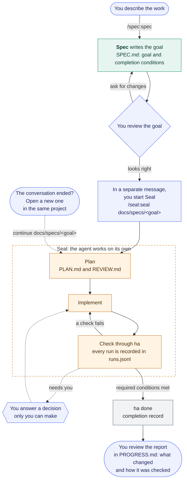
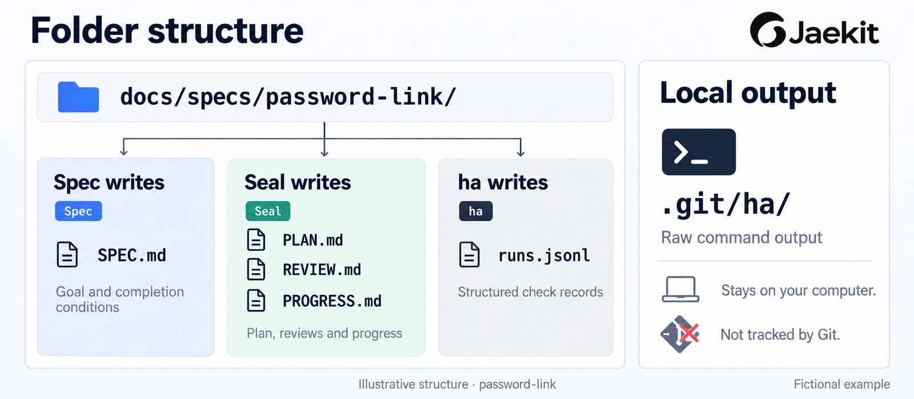
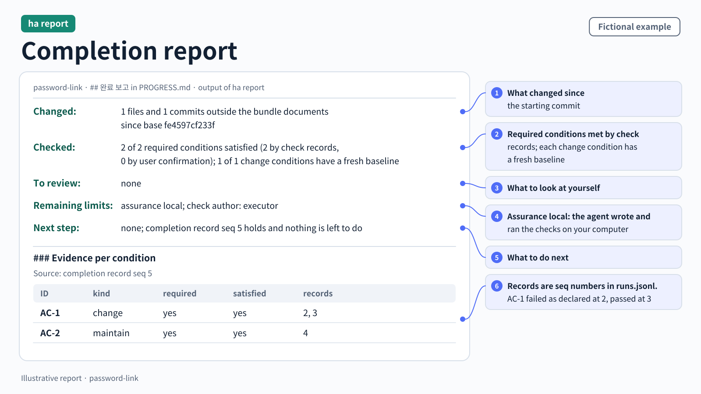

<p align="center">
  
</p>

<p align="center">
  <a href="https://github.com/jgoneit/jaekit/releases"></a>
  <a href="guides/INSTALL.en.md"></a>
  <a href="guides/INSTALL.en.md#basic-install"></a>
  <a href="LICENSE"></a>
</p>

<p align="center"><strong>English</strong> · <a href="README.ko.md">한국어</a><br /><a href="#install">Install</a> · <a href="#your-first-task">First task</a> · <a href="#update">Update</a> · <a href="#what-you-get">What you get</a> · <a href="guides/USAGE.en.md">Usage guide</a></p>

Jaekit **carries work you delegate to Codex or Claude Code from a goal to a completion record**.

- **Spec** turns what you want into a goal document with completion conditions.
- **Seal** has the agent implement, check, and fix the work toward that goal, and judges completion from check records.

The current release is **v0.1.6**, an early version being refined through real work.

## Why use it

- **You want "done" backed by records**<br>
  Completion is recorded only when the required completion conditions are met by recorded checks or necessary user confirmations. The completion report shows what changed and how it was checked.
- **You want to pick up where a conversation ended**<br>
  Goals, plans, and progress records stay in the project folder. In a new conversation, specify the same goal to continue from the saved point.
- **You do not want to approve every step**<br>
  The agent plans, implements, and checks on its own. It asks when a decision affects the outcome or a check needs your confirmation.
- **You want to define the request before implementing it**<br>
  Spec works on its own. Keep the goal and completion conditions as a document and start Seal when you are ready.

## How it works


An illustrated sequence, not a recording of a real run. The diagram below shows each step and who acts.



1. Spec writes the goal document and **stops**. Read it and say what needs changing.
2. When it looks right, **start Seal in a separate message**. The agent implements, checks, and fixes the work.
3. When the required completion conditions are met, Seal saves a completion record and report. Review **what changed and how it was checked**, along with the actual result.

<details>
<summary>View the same flow as an illustration</summary>


</details>

## Get started

### What you need

- **Git** and **a project folder managed with Git.** You do not need to clone the Jaekit repository.
- **Claude Code** or **[Codex CLI](https://learn.chatgpt.com/docs/codex/cli)**
- On macOS and Linux, **[Homebrew](https://brew.sh)** (a program installer) is recommended. Without it, install from a Release file.

### Install

First check what you can use in your environment.

| Environment | Spec | Seal | How to install |
| --- | --- | --- | --- |
| macOS (Apple Silicon, Intel) | Yes | Yes | The Homebrew command below |
| Linux (arm64, amd64) | Yes | Yes | The command below with Homebrew; otherwise [Install from a Release file](guides/INSTALL.en.md#install-from-a-release-file) |
| WSL2 on Windows (Ubuntu 24.04 x64) | Prepared, not yet checked in use | Prepared, not yet checked in use | Follow the [WSL2 preparation guide](guides/WSL.en.md) and install from a Release file |
| Windows (native) | Not checked | Not available | No public installation files yet |

Then check your agent.

| Agent | Spec | Seal | Call |
| --- | --- | --- | --- |
| Claude Code | Yes | Yes | `/spec:spec`, `/seal:seal` |
| Codex (CLI, desktop app) | Yes | Yes | `$spec:spec`, `$seal:seal` |

<details>
<summary><strong>Windows users</strong>: what works today</summary>

- In the current public release, the record tool `ha` does not support Windows natively, so Seal cannot run there. This limitation refers to native execution.
- Spec does not need `ha`, but its installation and operation on Windows have not been checked yet.
- In WSL2 with Ubuntu 24.04 LTS x64, install from the Linux Release file; Homebrew is not needed. Installation and agent use in actual WSL2 have not been checked yet. → [WSL2 preparation guide](guides/WSL.en.md)
- Native Windows (Windows 11 x64, PowerShell 5.1 and 7) has only a candidate under development; actual execution has not been checked. → [Windows native candidate guide](guides/WINDOWS.en.md)

</details>

#### 1. Install the record tool `ha` in Terminal

Run one block at a time and wait for it to finish.

```bash
brew install jgoneit/tap/jaekit
```

```bash
ha --version
which -a ha
```

It should print `ha 0.1.6`. The first line of `which -a ha` is the file that actually runs. If the command is missing or the version differs, see [Check the version](guides/INSTALL.en.md#check-the-version).

To install without Homebrew, paste the block under [Install from a Release file](guides/INSTALL.en.md#install-from-a-release-file) instead of this step. It downloads the file for your OS and CPU, checks its checksum, and puts it at `~/.local/bin/ha`. Other methods and details are in the [install guide](guides/INSTALL.en.md).

#### 2. Install the plugins for your agent

In the same Terminal, run only the block for the agent you use.

If you already installed Jaekit, follow [Update](#update) below. If you registered a repository checkout path, first see [Move from a local path registration](guides/INSTALL.en.md#move-from-a-local-path-registration).

**Claude Code**

```bash
claude plugin marketplace add jgoneit/jaekit#v0.1.6
claude plugin install spec@jaekit
claude plugin install seal@jaekit
claude plugin list
```

> [!TIP]
> **Reopen Claude Code after installation.** The final list should show `spec@jaekit` and `seal@jaekit` as enabled. `#v0.1.6` pins the release to use. For details, see [Claude Code installation](guides/INSTALL.en.md#claude-code).

**Codex**

```bash
codex plugin marketplace add jgoneit/jaekit@v0.1.6
codex plugin add spec@jaekit
codex plugin add seal@jaekit
```

> [!TIP]
> **Reopen Codex after installation.** `@v0.1.6` pins the release to use.

> [!NOTE]
> **Spar for `standard` and `strict` goals.** From the release after v0.1.6, `standard` and `strict` goals need the Spar executable and the Spar plugin, with reviewers set to the CLIs you have: see [Spar](guides/INSTALL.en.md#spar). That release's Seal starts new goals under `run-rules/5`, and a `standard` or `strict` goal started under `run-rules/5` completes only with a recorded Spar gate. `light` goals, goals without an `Assurance:` line and goals started under `run-rules/4` or earlier do not need Spar. To finish without review, you decide a goal-document change that lowers the tier to `light` ([Review gate](guides/USAGE.en.md#review-gate-run-rules5)).

### Your first task

Open Claude Code, Codex CLI, or the Codex desktop app in your project folder.

> [!IMPORTANT]
> From here on, type in the agent conversation, not Terminal.

#### 1. Ask Spec

Use the example for your agent and describe the work you want.

**Claude Code**

```text
/spec:spec Add a "Forgot password" link to the login screen
```

**Codex** — Type `$` and choose Jaekit's `spec:spec` from the list.

```text
$spec:spec Add a "Forgot password" link to the login screen
```

> [!NOTE]
> This is a **fictional example** of a project that already has a password reset page, not an executed or verified case. Replace it with the work you want in your own project.

#### 2. Review the goal

Read the document Spec gives you and say what needs changing.

In this example, the completion conditions are that the new link opens the existing reset page and login keeps working as before.

#### 3. Start Seal in a separate message

Specify the goal folder.

**Claude Code**

```text
/seal:seal docs/specs/<goal>
```

**Codex** — Choose Jaekit's `seal:seal` from the `$` list.

```text
$seal:seal docs/specs/<goal>
```

> [!TIP]
> Replace `<goal>` with **the actual goal folder name Spec reported**. If its name is `password-link`, the full path is `docs/specs/password-link`.

For more on sending commands, see the [usage guide](guides/USAGE.en.md#sending-commands).

### If the conversation ends

Open **a new conversation in the same project folder** and specify the same goal.

```text
continue docs/specs/<goal>
```

Replace `<goal>` with its actual folder name to continue from the saved goal and progress records.

### Update

> [!WARNING]
> When a new release comes out, update `ha` and both plugins **together**. With mixed versions, Seal may stop before recording.

#### 1. Update `ha`

If you installed it with Homebrew, run these two blocks in order.

```bash
brew update
```

```bash
brew upgrade jgoneit/tap/jaekit
```

If you installed from a Release file, paste the block under [Install from a Release file](guides/INSTALL.en.md#install-from-a-release-file) again.

#### 2. Check which `ha` actually runs

```bash
ha --version
which -a ha
```

If the new version does not appear, look at the first line of `which -a ha`. That is the file that actually runs.

If you installed both with Homebrew and from a Release file, remove the one you do not use or update it to the same version. Updating only one can leave the older one earlier on PATH still running.

#### 3. Register the plugins again for the new release

Removing the marketplace also removes its spec and seal, so install them again.

**Claude Code**

```bash
claude plugin marketplace remove jaekit
claude plugin marketplace add jgoneit/jaekit#v0.1.6
claude plugin install spec@jaekit
claude plugin install seal@jaekit
```

**Codex**

```bash
codex plugin marketplace remove jaekit
codex plugin marketplace add jgoneit/jaekit@v0.1.6
codex plugin add spec@jaekit
codex plugin add seal@jaekit
```

#### 4. Reopen Claude Code or Codex

The new Spec and Seal load in newly opened sessions.

Updating does not delete goal documents or run records. To clean up earlier versions' data or uninstall, see [Update](guides/INSTALL.en.md#update) and [Uninstall](guides/INSTALL.en.md#uninstall).

## What you get

Everything Jaekit writes stays in your project, in one folder per goal. The examples below are **synthetic and shortened**: they show the format, not a record of real work. Section names and markers such as `## Acceptance Criteria`, `## 조건표` and `AC-1` are fixed format tokens; some are in Korean, and [Korean section names](#korean-section-names) translates them. The prose is written in your language.



<details>
<summary>The same folder as text</summary>

```text
docs/specs/password-link/
├── SPEC.md        goal, scenarios, completion conditions          ← Spec
├── PLAN.md        how each condition is checked, scope, budget    ← Seal
├── REVIEW.md      review of the plan before work starts           ← Seal
├── PROGRESS.md    current state, timeline, completion report      ← Seal
└── runs.jsonl     append-only run record                          ← ha only

.git/ha/           raw check output, not tracked by Git (read it with ha log)
```

</details>

### The completion report



When the required conditions are met, Seal runs `ha done` and pastes its output unchanged into `PROGRESS.md` under `## 완료 보고`, followed by its own notes. On GitHub it looks like this:

> **ha status: docs/specs/password-link**
>
> - status: **complete** (exit 0)
> - completion record: seq 5
> - assurance: local (an agent with the same user permissions can change checks and records)
> - check author: executor
> - rules: run-rules/4; skill: seal 0.1.17 (claimed); ha: 0.1.6
>
> | ID | kind | required | satisfied | reason | records | attempts |
> | --- | --- | --- | --- | --- | --- | --- |
> | AC-1 | change | yes | yes | — | 2, 3 | checks 1 (fail 0, error 0), baselines 1 (unexpected pass 0, error 0), stale 0 |
> | AC-2 | maintain | yes | yes | — | 4 | checks 1 (fail 0, error 0), baselines 0 (unexpected pass 0, error 0), stale 0 |
>
> - Completion coverage: completion record seq 5 at commit aa4bd917b591, which is the head to push.
> - Changed files (agent's claim): src/login.html for AC-1.
> - Remaining limits: assurance local; the agent wrote the checks; no manual conditions.

<details>
<summary>View the same report as Markdown in <code>PROGRESS.md</code></summary>

```markdown
## 완료 보고

## ha status: docs/specs/password-link

- status: **complete** (exit 0)
- completion record: seq 5
- assurance: local (an agent with the same user permissions can change checks and records)
- check author: executor
- record head: seq 5 (315888484b42)
- rules: run-rules/4; skill: seal 0.1.17 (claimed); ha: 0.1.6
- code: aa4bd917b591, tree clean: yes; goal digest: f1f24cc156b0
- attempts: 3 total; types: 2 check, 1 baseline; outcomes: 0 environment errors, 0 unknown; inputs: 3 current, 0 stale; valid positive evidence: 3 (overlapping axes)

### Criteria

| ID | kind | required | satisfied | reason | records | attempts |
| --- | --- | --- | --- | --- | --- | --- |
| AC-1 | change | yes | yes | — | 2, 3 | checks 1 (fail 0, error 0), baselines 1 (unexpected pass 0, error 0), stale 0 |
| AC-2 | maintain | yes | yes | — | 4 | checks 1 (fail 0, error 0), baselines 0 (unexpected pass 0, error 0), stale 0 |

### Reasons

None.

- Completion coverage: completion record seq 5 at commit aa4bd917b591, which is the head to push.
- Changed files (agent's claim): src/login.html for AC-1.
- Remaining limits: assurance local; the agent wrote the checks; no manual conditions.
```

</details>

How to read it:

- **status** is computed by `ha` from the run record, Git and the goal documents; it is not the agent's own claim. A completion record seq means `ha done` recorded it.
- **records** are line numbers (seq) in `runs.jsonl`. For AC-1, seq 2 is the check run on the starting commit, failing as declared, and seq 3 is the same check passing on the result.
- The raw output of a run stays in `.git/ha/`. `ha log docs/specs/password-link 3` prints it in Terminal.

> [!IMPORTANT]
> **assurance: local** and **check author: executor** mean the agent wrote and ran the checks on your computer. This is not independent third-party verification, so review the changed checks and the actual result too.

If the work stops before completion, the report shows `ha status` instead, with an `### Unmet` list of what is missing:

```text
- status: **incomplete** (exit 1)

### Unmet

- AC-2 `criterion_failed` (executor): seq 4, output `ha log docs/specs/password-link 4`
```

### The other files

<details>
<summary><strong>SPEC.md</strong>: what you want, as conditions that can be checked</summary>

```markdown
# Forgot password link

Status: Ready
Criteria-Format: nested/1

## Goal

Add a "Forgot password?" link to the login screen that opens the existing reset page.

## 사용 시나리오

A user who forgot their password selects the link and reaches the reset page (AC-1).
Signing in keeps working as before (AC-2).

## Acceptance Criteria
- **AC-1** The login screen shows a "Forgot password?" link to `/reset-password`.
- **AC-2** The existing login form keeps working.

## Open Decisions

None
```

`Status: Ready` means no outcome-changing decision is left. Spec stops here; nothing is implemented until you start Seal.

</details>

<details>
<summary><strong>PLAN.md</strong>: how Seal checks each condition</summary>

```markdown
## 조건표
| ID | 종류 | 검증 명령 | 검사 경로 | Task |
| --- | --- | --- | --- | --- |
| AC-1 | change | `python3 checks/login_link.py` | checks/login_link.py, checks/login-link.json | T001 |
| AC-2 | maintain | `python3 -m unittest tests.test_login` | — | T001 |

## 결과 계약
| ID | 선언 경로 |
| --- | --- |
| AC-1 | checks/login-link.json |
```

- `change` is new behavior. Seal also runs its check on the starting commit, where it must fail the way the declaration says, and then on the result, where it must pass.
- `maintain` is behavior that must keep working. `manual` is a condition only you can confirm.
- The plan also lists the paths Seal may change, its tasks and a run budget. `REVIEW.md` records the review of this plan before work starts.

</details>

<details>
<summary><strong>runs.jsonl</strong>: the run record behind the report</summary>

`ha` appends one JSON line for each recorded event: `start`; a `check` or `baseline` line for each target it runs, so `ha check <goal> AC-1 AC-2` adds two lines; `note` (your quoted confirmations and answers); `budget_change`; `done`; and `finding` for findings recorded after completion. Each line carries the hash of the line before it (`prev`), so editing or removing an earlier line breaks the chain and `ha` reports `record_integrity`. The last line has no later line to expose a change. The record head (seq and hash) in the completion report is the last line when `ha done` ran; later lines such as notes or findings can follow it. A shortened `done` line:

```text
{"schema":"run/v1","seq":5,"prev":"a22dbbfe…","kind":"done","status":"complete","commit":"aa4bd917…","tree_clean":true,"criteria":[{"id":"AC-1","kind":"change","satisfied":true,"records":[2,3]},{"id":"AC-2","kind":"maintain","satisfied":true,"records":[4]}]}
```

</details>

### Korean section names

Some fixed section names and table columns stay in Korean in every language, because `ha` and the skills read them by these exact names. The prose under them is written in your language.

| File | Korean token | Meaning |
| --- | --- | --- |
| `SPEC.md` | `## 사용 시나리오` | Usage scenarios, each linked to criteria |
| `SPEC.md` | `흐름` · `경계` · `유지` | Scenario kinds: flow, boundary, keep as is |
| `PLAN.md` | `## 조건표` | Condition table: `ID`, `종류` (kind), `검증 명령` (check command), `검사 경로` (check paths), `Task` |
| `PLAN.md` | `## 결과 계약` | Result contract: the declaration file of each `change` condition |
| `PLAN.md` | `## 범위` · `## 예산` | Scope (paths Seal may change, tests, behavior to keep) · budget (runs and elapsed time) |
| `PLAN.md` | `## 읽을 자료` · `## 시간 제한` | Reading list · per-check time limits |
| `PROGRESS.md` | `## 현재` · `## Task 상태` | Current state · task status |
| `PROGRESS.md` | `## 타임라인` · `## 계획 변경` · `## 막힘` · `## 개선 메모` | Timeline · plan changes · blocks · improvement notes |
| `PROGRESS.md` | `## 완료 보고` · `## 완료 뒤 발견` | Completion report · findings after completion |

More on these files: [Reading the completion report](guides/USAGE.en.md#reading-the-completion-report) · [Saved files](guides/USAGE.en.md#saved-files) · [Format examples](examples/README.md) (in Korean)

## Before you start

<details>
<summary><strong>What should I look for in the completion report?</strong></summary>

Required completion conditions need recorded checks or necessary user confirmations.

The agent writes the automated checks, so completion is not a guarantee that the entire result is flawless or independently verified by a third party. Review the report's assumptions and remaining limitations alongside the actual result.

The default result ends at local changes and commits (saved entries in the change history). Publish to GitHub, create pull requests, and deploy yourself, or ask a general-purpose agent separately. [Reading the completion report](guides/USAGE.en.md#reading-the-completion-report)

</details>

<details>
<summary><strong>Can I just define a goal?</strong></summary>

Yes. Spec works without Seal or `ha`. Define the goal now and start Seal when you are ready to implement it.

</details>

<details>
<summary><strong>What records are saved?</strong></summary>

The project keeps goal documents, work plans, progress and completion reports, and run records. Read the progress report in `PROGRESS.md` in the goal folder. See [What you get](#what-you-get) for examples.

Installing, updating, or uninstalling does not delete these records. Git tracking follows project policy; review the contents before publishing. [Saved files](guides/USAGE.en.md#saved-files)

</details>

## More

- [Install, update, and uninstall](guides/INSTALL.en.md) · [Releases and compatibility](guides/INSTALL.en.md#release-and-development-combinations)
- [Usage, changing a goal, and resuming](guides/USAGE.en.md) · [Troubleshooting](guides/USAGE.en.md#troubleshooting)
- [Detailed operations](guides/OPERATIONS.en.md) · [Command and record formats](contracts/run-record.md) (in Korean)
- [WSL2 preparation guide](guides/WSL.en.md) · [Windows native candidate guide](guides/WINDOWS.en.md)
- [About the images and how to edit them](assets/readme/SOURCES.en.md)
- [What Ubuntu, macOS and Windows CI checks](guides/CI.en.md)
- [Independent review rounds with Spar](guides/SPAR.en.md), needed for `standard` and `strict` goals from the release after v0.1.6

Share your experience or where you got stuck in a [usage report or install/bug issue](https://github.com/jgoneit/jaekit/issues/new/choose). Issues are public: leave out company code, internal names, secrets, and raw logs.

[MIT license](LICENSE)
