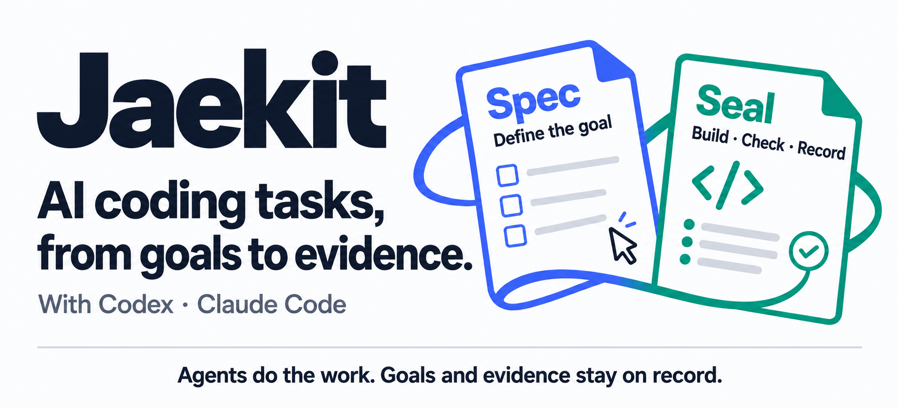
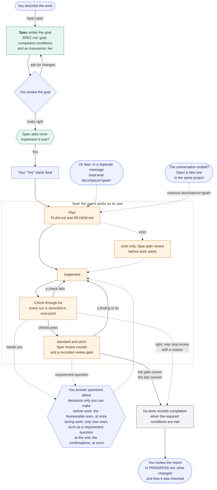

<p align="center">
  
</p>

<p align="center">
  <a href="https://github.com/jgoneit/jaekit/releases"></a>
  <a href="guides/INSTALL.en.md"></a>
  <a href="guides/INSTALL.en.md#basic-install"></a>
  <a href="LICENSE"></a>
</p>

<p align="center"><strong>English</strong> · <a href="README.ko.md">한국어</a><br /><a href="#install">Install</a> · <a href="#your-first-task">First task</a> · <a href="#update">Update</a> · <a href="#what-you-get">What you get</a> · <a href="guides/USAGE.en.md">Usage guide</a></p>

Jaekit lets you **check from records whether work you delegate to Claude Code or Codex is really done**. You settle what finished means as a goal before the work starts, and completion is judged from the check records left for each condition.

- Say what you want, and **Spec** writes down the goal and its completion conditions first.
- Review it and answer yes, and your agent follows **Seal** to plan, build and check toward that goal, then leaves a completion report based on the check records.

The current release is **v0.1.8**, an early version being refined through real work.

## Why use it

When an agent says "done", there is still checking left: whether a requested condition was skipped, whether a hard condition was read as an easier one, whether existing behavior still works, and what was actually checked. When a conversation ends, you explain again what was promised and how far it got.

Jaekit holds on to three things and leaves the rest to the agent you already use.

- **You set the goal.**<br>
  What finished means is written down before the work starts, and the agent does not edit that document while implementing. You can also use Spec alone, just to write the goal down.
- **The agent does the work.**<br>
  It plans, implements, and checks on its own, and asks only when a decision affects the outcome or a check needs your confirmation. You do not approve every step.
- **Completion is judged from records.**<br>
  Completion is recorded only when the required completion conditions are met by recorded checks or necessary user confirmations. The goal and progress records stay in the project folder, so you can continue the same goal in a new conversation.

[Understanding Jaekit](guides/OVERVIEW.en.md) explains from the start why it is shaped this way and how one goal goes through.

## How it works

![Fictional walkthrough of password-link in five scenes: you ask Spec with /spec:spec; you review the goal it wrote; you start by answering Yes when Spec asks whether to implement it now, or later with /seal:seal docs/specs/password-link in a separate message; the agent then works through commands you do not type: AC-1 fails before the change and passes after it, AC-2 still passes, a Spar review round runs and its gate is recorded, and ha done records completion; last, you read the completion report.](assets/readme/demo.en.gif)

You do three things: say what you want, review the goal Spec wrote and answer yes, and read the report at the end. The agent plans, implements, and checks in between, and `ha` records every check it runs. An illustrated sequence, not a recording of a real run. The diagram below shows the same flow in detail, branches included. What changes with the review tier (`Assurance:`) is summed up in [Review tiers](guides/OVERVIEW.en.md#review-tiers) in Understanding Jaekit.



1. Spec writes the goal document with its completion conditions and an `Assurance:` tier, asks once whether to implement it now, and **stops**. Read it and say what needs changing.
2. When it looks right, answer **yes** and Seal starts. You can also **start Seal in a separate message** later by naming the goal folder.
3. The agent plans, implements and checks the work through `ha`, which records every run. `standard` and `strict` goals get independent Spar review rounds before completion, and `strict` goals also get a plan review before work starts; `light` goals may skip review with a reason. Seal asks you about decisions only you can make: before work, the ones it can foresee, in one message; during work, only new questions, such as one that would change the requirements; at the end, the confirmations completion needs, in one message.
4. `ha done` records completion when the required completion conditions are met; for `standard` and `strict` goals, a recorded review gate must also cover the last commit. Review the report in `PROGRESS.md`: **what changed and how it was checked**, along with the actual result. If the conversation ends, continue the same goal in a new conversation.

<details>
<summary>View the same flow as an illustration</summary>

![Concept illustration of the usage flow. 1. Ask Spec: it writes the goal, completion conditions and an Assurance tier, then asks whether to implement it now. 2. Answer Yes and Seal starts; naming the goal folder in a separate message works too. 3. The agent plans, implements and checks through ha, which records every run; standard and strict goals get Spar review rounds and a review gate before completion (strict also a plan review), light goals may skip review with a reason, and Seal asks you about decisions only you can make: the foreseeable ones in one message before work, only new ones such as a requirement question during work, and the confirmations in one message at the end. 4. ha done records completion when the required conditions are met and, for standard and strict goals, the recorded review gate covers the last commit; the report lands in PROGRESS.md. To resume in a new conversation, specify the same goal in the same project.](assets/readme/usage-flow.en.png)

</details>

## Get started

### What you need

- **Git** and **a project folder managed with Git.** You do not need to clone the Jaekit repository.
- **Claude Code** or **[Codex CLI](https://learn.chatgpt.com/docs/codex/cli)**
- On macOS and Linux, **[Homebrew](https://brew.sh)** (a program installer) is recommended. Without it, install from a Release file.

### Install

First check what you can use in your environment.

| Environment | Spec | Seal | How to install |
| --- | --- | --- | --- |
| macOS (Apple Silicon, Intel) | Yes | Yes | The Homebrew command below |
| Linux (arm64, amd64) | Yes | Yes | The command below with Homebrew; otherwise [Install from a Release file](guides/INSTALL.en.md#install-from-a-release-file) |
| WSL2 on Windows (Ubuntu 24.04 x64) | Prepared, not yet checked in use | Prepared, not yet checked in use | Follow the [WSL2 preparation guide](guides/WSL.en.md) and install from a Release file |
| Windows (native) | Not checked | Not available | No public installation files yet |

Then check your agent.

| Agent | Spec | Seal | Call |
| --- | --- | --- | --- |
| Claude Code | Yes | Yes | `/spec:spec`, `/seal:seal` |
| Codex (CLI, desktop app) | Yes | Yes | `$spec:spec`, `$seal:seal` |

<details>
<summary><strong>Windows users</strong>: what works today</summary>

- In the current public release, the record tool `ha` does not support Windows natively, so Seal cannot run there. This limitation refers to native execution.
- Spec does not need `ha`, but its installation and operation on Windows have not been checked yet.
- In WSL2 with Ubuntu 24.04 LTS x64, install from the Linux Release file; Homebrew is not needed. Installation and agent use in actual WSL2 have not been checked yet. → [WSL2 preparation guide](guides/WSL.en.md)
- Native Windows (Windows 11 x64, PowerShell 5.1 and 7) has only a candidate under development; actual execution has not been checked. → [Windows native candidate guide](guides/WINDOWS.en.md)

</details>

#### 1. Install the record tool `ha` in Terminal

Run one block at a time and wait for it to finish. Homebrew installs `ha` and `spar` together.

```bash
brew install jgoneit/tap/jaekit
```

```bash
ha --version
which -a ha
spar --version
which -a spar
```

It should print `ha 0.1.8`. The first line of `which -a ha` is the file that actually runs. If the command is missing or the version differs, see [Check the version](guides/INSTALL.en.md#check-the-version).

To install without Homebrew, paste the block under [Install from a Release file](guides/INSTALL.en.md#install-from-a-release-file) instead of this step. It downloads the file for your OS and CPU, checks its checksum, and puts `ha` and `spar` at `~/.local/bin/ha` and `~/.local/bin/spar`. Other methods and details are in the [install guide](guides/INSTALL.en.md).

#### 2. Install the plugins for your agent

In the same Terminal, run only the block for the agent you use.

If you already installed Jaekit, follow [Update](#update) below. If you registered a repository checkout path, first see [Move from a local path registration](guides/INSTALL.en.md#move-from-a-local-path-registration).

**Claude Code**

```bash
claude plugin marketplace add jgoneit/jaekit#v0.1.8
claude plugin install spec@jaekit
claude plugin install seal@jaekit
claude plugin install spar@jaekit
claude plugin list
```

> [!TIP]
> **Reopen Claude Code after installation.** The final list should show `spec@jaekit`, `seal@jaekit` and `spar@jaekit` as enabled. `#v0.1.8` pins the release to use. For details, see [Claude Code installation](guides/INSTALL.en.md#claude-code).

**Codex**

```bash
codex plugin marketplace add jgoneit/jaekit@v0.1.8
codex plugin add spec@jaekit
codex plugin add seal@jaekit
codex plugin add spar@jaekit
```

> [!TIP]
> **Reopen Codex after installation.** `@v0.1.8` pins the release to use.

> [!NOTE]
> **Spar for `standard` and `strict` goals.** From v0.1.7, `standard` and `strict` goals need the Spar executable and the Spar plugin, which the commands above install, with reviewers set to the CLIs you have: see [Spar](guides/INSTALL.en.md#spar). The v0.1.7 Seal starts new goals under `run-rules/5`, and a `standard` or `strict` goal started under `run-rules/5` completes only with a recorded Spar gate. `light` goals, goals without an `Assurance:` line and goals started under `run-rules/4` or earlier do not need Spar. To finish without review, you decide a goal-document change that lowers the tier to `light` ([Review gate](guides/USAGE.en.md#review-gate-run-rules5)).

### Before your first `standard` goal

Add `docs/reviews/` to your project's `.gitignore` before its first `standard` or `strict` goal. Spar writes review records only to a folder Git ignores, and in a project that has never run Spar, Git does not ignore that folder yet, so the first review round would stop. `light` goals and goals that do not use Spar do not need this step.

```text
docs/reviews/
```

To use another folder or `.git/info/exclude` instead, see [Set up a project](guides/SPAR.en.md#set-up-a-project) in the Spar guide.

### Your first task

Open Claude Code, Codex CLI, or the Codex desktop app in your project folder.

> [!IMPORTANT]
> From here on, type in the agent conversation, not Terminal.

#### 1. Ask Spec

Use the example for your agent and describe the work you want.

**Claude Code**

```text
/spec:spec Add a "Forgot password" link to the login screen
```

**Codex** — Type `$` and choose Jaekit's `spec:spec` from the list.

```text
$spec:spec Add a "Forgot password" link to the login screen
```

> [!NOTE]
> This is a **fictional example** of a project that already has a password reset page, not an executed or verified case. Replace it with the work you want in your own project.

#### 2. Review the goal

Read the document Spec gives you and say what needs changing.

In this example, the completion conditions are that the new link opens the existing reset page and login keeps working as before.

#### 3. Answer yes to start Seal

When no decision is left open, Spec ends its report by asking whether to implement the goal now. When the goal looks right, answer **yes**: Seal starts on that goal.

To start later instead, specify the goal folder in a separate message.

**Claude Code**

```text
/seal:seal docs/specs/<goal>
```

**Codex** — Choose Jaekit's `seal:seal` from the `$` list.

```text
$seal:seal docs/specs/<goal>
```

> [!TIP]
> Replace `<goal>` with **the actual goal folder name Spec reported**. If its name is `password-link`, the full path is `docs/specs/password-link`.

For more on sending commands, see the [usage guide](guides/USAGE.en.md#sending-commands).

### If the conversation ends

Open **a new conversation in the same project folder** and specify the same goal.

```text
continue docs/specs/<goal>
```

Replace `<goal>` with its actual folder name to continue from the saved goal and progress records.

### Update

> [!WARNING]
> When a new release comes out, update `ha` and the plugins **together**. With mixed versions, Seal may stop before recording.

#### 1. Update `ha`

If you installed it with Homebrew, run these two blocks in order.

```bash
brew update
```

```bash
brew upgrade jgoneit/tap/jaekit
```

If you installed from a Release file, paste the block under [Install from a Release file](guides/INSTALL.en.md#install-from-a-release-file) again.

#### 2. Check which `ha` actually runs

```bash
ha --version
which -a ha
spar --version
which -a spar
```

If the new version does not appear, look at the first line of `which -a ha`. That is the file that actually runs.

If you installed both with Homebrew and from a Release file, remove the one you do not use or update it to the same version. Updating only one can leave the older one earlier on PATH still running.

#### 3. Register the plugins again for the new release

Removing the marketplace also removes its spec, seal and spar, so install them again.

**Claude Code**

```bash
claude plugin marketplace remove jaekit
claude plugin marketplace add jgoneit/jaekit#v0.1.8
claude plugin install spec@jaekit
claude plugin install seal@jaekit
claude plugin install spar@jaekit
```

**Codex**

```bash
codex plugin marketplace remove jaekit
codex plugin marketplace add jgoneit/jaekit@v0.1.8
codex plugin add spec@jaekit
codex plugin add seal@jaekit
codex plugin add spar@jaekit
```

#### 4. Reopen Claude Code or Codex

The new Spec, Seal and Spar load in newly opened sessions.

Updating does not delete goal documents or run records. To clean up earlier versions' data or uninstall, see [Update](guides/INSTALL.en.md#update) and [Uninstall](guides/INSTALL.en.md#uninstall).

## What you get

Everything Jaekit writes stays in your project, in one folder per goal. The examples below are **synthetic and shortened**: they show the format, not a record of real work. Section names and markers such as `## Acceptance Criteria`, `## 조건표` and `AC-1` are fixed format tokens; some are in Korean, and [Korean section names](#korean-section-names) translates them. The prose is written in your language.


Spar writes to `docs/reviews/` only once your project's Git ignores it: see [Before your first `standard` goal](#before-your-first-standard-goal).

<details>
<summary>The same folder as text</summary>

```text
docs/specs/password-link/
├── SPEC.md        goal, scenarios, completion conditions          ← Spec
├── PLAN.md        how each condition is checked, scope, budget    ← Seal
├── REVIEW.md      review plan; summary of the Spar rounds and gate ← Seal
├── PROGRESS.md    current state, timeline, completion report      ← Seal
└── runs.jsonl     append-only run record                          ← ha only

docs/reviews/password-link/   Spar records, in a folder your project's Git is set up to ignore
├── 01-candidate/  one review round: packet, findings, summary     ← Spar
└── gate.json      the review gate, recorded with ha note          ← Spar

.git/ha/           raw check output, not tracked by Git (read it with ha log)
```

</details>

### The completion report


When `ha done` records completion, Seal pastes the output of `ha report` unchanged into `PROGRESS.md` under `## 완료 보고`, then adds only its own judgment below it. `ha report` prints English by default and Korean with `--lang ko`; Seal uses the language of your request. The section looks like this:

```markdown
## 완료 보고

Changed: 1 files and 1 commits outside the bundle documents since base f46020ce6f77
Checked: 2 of 2 required conditions satisfied (2 by check records, 0 by user confirmation); 1 of 1 change conditions have a fresh baseline
To review: none
Remaining limits: assurance local; check author: executor
Next step: none; completion record seq 6 holds and nothing is left to do

### Stamp for `## 현재`

- record head: seq 6 (e2fd520c706e), recorded at 2026-10-23T13:38:16Z; status: complete; completion record: seq 6

### Evidence per condition

Source: completion record seq 6
| ID | kind | required | satisfied | records |
| --- | --- | --- | --- | --- |
| AC-1 | change | yes | yes | 2, 3 |
| AC-2 | maintain | yes | yes | 4 |

### Completion coverage

- completion record seq 6, commit e01fdf1e9c98; HEAD e01fdf1e9c98 is covered

### Output of unmet conditions

- none

Seal's judgment:

- Changed files (agent's claim): src/login.html for AC-1.
- Manual conditions and assumed decisions: none.
- Review: tier `standard`. Spar round `01-candidate` (claude, codex) found nothing, and its gate, recorded at seq 5, covers the last commit e01fdf1e9c98. No reviewer was waived. The records are in `docs/reviews/password-link/`.
- The head to push is the completion record's commit e01fdf1e9c98.
- This report does not establish deployment or installation. Assurance is local, and the agent wrote the checks.
```

How to read it:

- The five lines at the top say what changed, what was checked, what you should look at yourself, the limits that remain and the next step. `ha report` computes them from the run record, Git and the goal documents; they are not the agent's own claim.
- **records** are line numbers (seq) in `runs.jsonl`. For AC-1, seq 2 is the check run on the starting commit, failing as declared, and seq 3 is the same check passing on the result. Seq 5 is the `review` note that recorded the Spar gate, and completion record seq 6 means `ha done` recorded completion.
- The raw output of a run stays in `.git/ha/`. `ha log docs/specs/password-link 3` prints it in Terminal.

> [!IMPORTANT]
> **assurance local** and **check author: executor** under `Remaining limits` mean the agent wrote and ran the checks on your computer. This is not independent third-party verification, so review the changed checks and the actual result too.

If the work stops before completion, Seal still pastes `ha report`. `Next step` names what to resolve, and the last section shows where each unmet condition's output is:

```text
Next step: resolve AC-2 `criterion_failed` (executor)

### Output of unmet conditions

- AC-2 `criterion_failed` (executor): seq 4, output `ha log docs/specs/password-link 4`
```

To see what one goal cost in checks and review rounds, run `ha cost docs/specs/<goal> --series docs/reviews/<goal>` in Terminal. It only reads the records. See [Reading one goal's cost](guides/USAGE.en.md#reading-one-goals-cost).

### The other files

<details>
<summary><strong>SPEC.md</strong>: what you want, as conditions that can be checked</summary>

```markdown
# Forgot password link

Status: Ready
Criteria-Format: nested/1
Assurance: standard

## Goal

Add a "Forgot password?" link to the login screen that opens the existing reset page.

## 사용 시나리오

A user who forgot their password selects the link and reaches the reset page (AC-1).
Signing in keeps working as before (AC-2).

## Acceptance Criteria
- **AC-1** The login screen shows a "Forgot password?" link to `/reset-password`.
- **AC-2** The existing login form keeps working.

## Open Decisions

None
```

`Status: Ready` means no outcome-changing decision is left. `Assurance: standard` is the review tier: before `ha done`, Seal has the change reviewed in independent Spar rounds. Spec stops here; nothing is implemented until you start Seal.

</details>

<details>
<summary><strong>PLAN.md</strong>: how Seal checks each condition</summary>

```markdown
## 조건표
| ID | 종류 | 검증 명령 | 검사 경로 | Task |
| --- | --- | --- | --- | --- |
| AC-1 | change | `python3 checks/login_link.py` | checks/login_link.py, checks/login-link.json | T001 |
| AC-2 | maintain | `python3 -m unittest tests.test_login` | — | T001 |

## 결과 계약
| ID | 선언 경로 |
| --- | --- |
| AC-1 | checks/login-link.json |
```

- `change` is new behavior. Seal also runs its check on the starting commit, where it must fail the way the declaration says, and then on the result, where it must pass.
- `maintain` is behavior that must keep working. `manual` is a condition only you can confirm.
- The plan also lists the paths Seal may change, its tasks and a run budget. `REVIEW.md` holds the review of this plan, the review tier and the planned review stages, and later summarizes the Spar rounds and gate, pointing to their records in `docs/reviews/password-link/`.

</details>

<details>
<summary><strong>runs.jsonl</strong>: the run record behind the report</summary>

`ha` appends one JSON line for each recorded event: `start`; a `check` or `baseline` line for each target it runs, so `ha check <goal> AC-1 AC-2` adds two lines; `note` (your quoted confirmations and answers, and the `review` note that records a Spar gate); `budget_change`; `done`; and `finding` for findings recorded after completion. Each line carries the hash of the line before it (`prev`), so editing or removing an earlier line breaks the chain and `ha` reports `record_integrity`. The last line has no later line to expose a change. The record head (seq and hash) in the completion report is the last line when `ha done` ran; later lines such as notes or findings can follow it. A shortened `done` line:

```text
{"schema":"run/v1","seq":6,"prev":"578fb93e…","kind":"done","status":"complete","commit":"e01fdf1e…","tree_clean":true,"criteria":[{"id":"AC-1","kind":"change","satisfied":true,"records":[2,3]},{"id":"AC-2","kind":"maintain","satisfied":true,"records":[4]}]}
```

</details>

### Korean section names

Some fixed section names and table columns stay in Korean in every language, because `ha` and the skills read them by these exact names. The prose under them is written in your language.

| File | Korean token | Meaning |
| --- | --- | --- |
| `SPEC.md` | `## 사용 시나리오` | Usage scenarios, each linked to criteria |
| `SPEC.md` | `흐름` · `경계` · `유지` | Scenario kinds: flow, boundary, keep as is |
| `PLAN.md` | `## 조건표` | Condition table: `ID`, `종류` (kind), `검증 명령` (check command), `검사 경로` (check paths), `Task` |
| `PLAN.md` | `## 결과 계약` | Result contract: the declaration file of each `change` condition |
| `PLAN.md` | `## 범위` · `## 예산` | Scope (paths Seal may change, tests, behavior to keep) · budget (runs and elapsed time) |
| `PLAN.md` | `## 읽을 자료` · `## 시간 제한` | Reading list · per-check time limits |
| `PROGRESS.md` | `## 현재` · `## Task 상태` | Current state · task status |
| `PROGRESS.md` | `## 타임라인` · `## 계획 변경` · `## 막힘` · `## 개선 메모` | Timeline · plan changes · blocks · improvement notes |
| `PROGRESS.md` | `## 완료 보고` · `## 완료 뒤 발견` | Completion report · findings after completion |

More on these files: [Reading the completion report](guides/USAGE.en.md#reading-the-completion-report) · [Saved files](guides/USAGE.en.md#saved-files) · [Format examples](examples/README.md) (in Korean)

## Before you start

<details>
<summary><strong>What should I look for in the completion report?</strong></summary>

Required completion conditions need recorded checks or necessary user confirmations.

The agent writes the automated checks, so completion is not a guarantee that the entire result is flawless or independently verified by a third party. Review the report's assumptions and remaining limitations alongside the actual result.

The default result ends at local changes and commits (saved entries in the change history). Publish to GitHub, create pull requests, and deploy yourself, or ask a general-purpose agent separately. [Reading the completion report](guides/USAGE.en.md#reading-the-completion-report)

</details>

<details>
<summary><strong>Can I just define a goal?</strong></summary>

Yes. Spec works without Seal or `ha`. Define the goal now and start Seal when you are ready to implement it.

</details>

<details>
<summary><strong>What records are saved?</strong></summary>

The project keeps goal documents, work plans, progress and completion reports, and run records. Read the progress report in `PROGRESS.md` in the goal folder. See [What you get](#what-you-get) for examples.

Installing, updating, or uninstalling does not delete these records. Git tracking follows project policy; review the contents before publishing. [Saved files](guides/USAGE.en.md#saved-files)

</details>

## More

**Get started**

- [Understanding Jaekit](guides/OVERVIEW.en.md): why it is shaped this way, how one goal goes through, what completion means
- [Install, update, and uninstall](guides/INSTALL.en.md) · [Releases and compatibility](guides/INSTALL.en.md#release-and-development-combinations)
- [WSL2 preparation guide](guides/WSL.en.md): to use Jaekit on Windows

**Use**

- [Usage, changing a goal, and resuming](guides/USAGE.en.md) · [Troubleshooting](guides/USAGE.en.md#troubleshooting)
- [Reading work status and the completion report](guides/OPERATIONS.en.md): why work stopped and what a report rests on
- [Independent review rounds with Spar](guides/SPAR.en.md), needed for `standard` and `strict` goals from v0.1.7

**File and record formats and rules** (you do not need them to hand work to your agent; in Korean)

- [Formats and rules overview](contracts/README.md) · [Command and record formats](contracts/run-record.md)

**Developing Jaekit**

- [Building from source and registering for development](guides/DEVELOPMENT.en.md) · [What Ubuntu, macOS and Windows CI checks](guides/CI.en.md)
- [Windows native candidate guide](guides/WINDOWS.en.md) · [About the images and how to edit them](assets/readme/SOURCES.en.md)

Share your experience or where you got stuck in a [usage report or install/bug issue](https://github.com/jgoneit/jaekit/issues/new/choose). Issues are public: leave out company code, internal names, secrets, and raw logs.

[MIT license](LICENSE)
