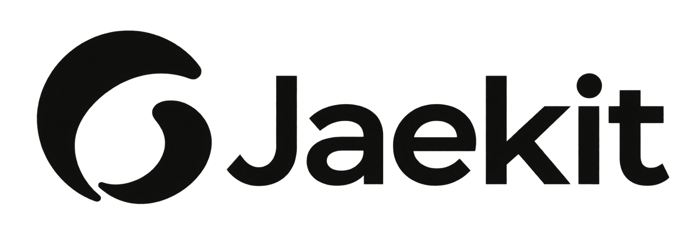

# README image guide

[한국어](SOURCES.md)

The README uses supplied Jaekit branding alongside conceptual illustrations of the product's roles.

## Branding

| Use | Preview | Files |
| --- | --- | --- |
| Primary logo |  | [Original PNG](brand/logo.png) · [Display SVG](brand/logo.svg) |
| Wordmark |  | [Original PNG](brand/wordmark.png) · [Display SVG](brand/wordmark.svg) |
| Small symbol |  | [Original PNG](brand/symbol.png) · [Display SVG](brand/symbol.svg) |

The three supplied PNGs are preserved unchanged. Each display SVG embeds the original PNG bytes on a rounded white surface so the black artwork stays visible in dark mode. The original aspect ratio and transparent padding are preserved. The README opens with the hero image, which includes the wordmark; the logo, wordmark and symbol are shown here for reference.

Rebuild the display SVGs with [build_brand.py](source/build_brand.py). It uses only the Python 3 standard library. Run it from the repository root; it does not modify the PNGs.

```bash
python3 assets/readme/source/build_brand.py
```

## Conceptual illustrations

The hero, usage flow, walkthrough, folder structure and report card are **conceptual illustrations** of Jaekit's roles and usage flow. They are not screenshots, execution results, or evidence of completion or passed checks. The `password-link` goal, conditions and record numbers in the walkthrough and card are fictional too. The password-link request in the README is also a fictional example.

| Image | 한국어 | English | Scalable SVG |
| --- | --- | --- | --- |
| Hero | [hero.ko.png](hero.ko.png) | [hero.en.png](hero.en.png) | — |
| Usage flow | [usage-flow.ko.png](usage-flow.ko.png) | [usage-flow.en.png](usage-flow.en.png) | [ko](usage-flow.ko.svg) · [en](usage-flow.en.svg) |
| Walkthrough (both READMEs) | — | [demo.en.gif](demo.en.gif) | [frames](source/walkthrough/) |
| Folder structure | [goal-folder.ko.png](goal-folder.ko.png) | [goal-folder.en.png](goal-folder.en.png) | [ko](goal-folder.ko.svg) · [en](goal-folder.en.svg) |
| Report card | [report-card.ko.png](report-card.ko.png) | [report-card.en.png](report-card.en.png) | [ko](report-card.ko.svg) · [en](report-card.en.svg) |

The README uses PNG and GIF for preview compatibility. Alt text and nearby prose explain the images without relying on the artwork.

## Illustration source and editing

The two hero images were imported from the supplied README kit. Its creation notes record that the Korean artwork was made with OpenAI image generation and then localized into English. The [image prompts](source/IMAGE-PROMPTS.md) preserve the copy and composition instructions. PNGs have no editable text layers, so review both languages' wording and legibility after editing.

The usage flow, walkthrough, folder structure and report card are authored as SVG. Each has a generator script: [usage flow](source/build_usage_flow.py), [walkthrough](source/build_walkthrough.py), [folder structure](source/build_goal_folder.py) and [report card](source/build_report_card.py). Shared drawing code is in [readme_svg.py](source/readme_svg.py); copy and layout are in each script. [build_readme_images.py](source/build_readme_images.py) builds the SVGs of all four, and [render_readme_images.cjs](source/render_readme_images.cjs) renders the PNGs of both languages and the walkthrough GIF the README uses. The GIF is assembled from SVG frames. [renders.json](source/renders.json) records, by sha256, which SVG each rendered file came from. The [artwork source guide](source/ARTWORK.md) lists the files and how to rebuild them.

The final SVGs use outlined text and need no installed fonts. Python 3 with fonttools and Node.js with sharp are needed **only to edit the artwork**, not to use Jaekit or run the standard repository checks. The typeface is Noto Sans CJK KR; its [SIL OFL 1.1 license](source/FONT-LICENSE.txt) is included, but the font binaries are not.

## Meaning to preserve

- Spec defines the goal, completion conditions and an `Assurance:` tier, asks once whether to implement it now, then stops. The user's yes starts Seal; **starting Seal in a separate message** is shown as the other way in.
- The Codex or Claude Code agent performs planning, implementation, checks and fixes, and `ha` records every check run.
- `standard` and `strict` goals get independent Spar review rounds before completion, and `strict` goals also get a plan review before work. `light` goals may skip review with a reason. Questions that would change the requirements go to the user.
- `ha done` records completion when the required completion conditions are met; for `standard` and `strict`, a recorded review gate must cover the last commit. The completion report stays in `PROGRESS.md`.
- Spar's rounds and gate stay in a folder Git ignores (for example `docs/reviews/<goal>/`); raw check output stays in `.git/ha/`.
- Resuming requires naming the same goal in a new conversation in the same project.
- The completion report has the shape of `ha report` output (five summary lines and evidence per condition), and assurance stays `local`. Do not illustrate unrun checks as passed, or show Spar review as certified verification or automatic deployment.
- Update both languages' images and alt text together.

Follow the [usage guide](../../guides/USAGE.en.md) for product behavior.
