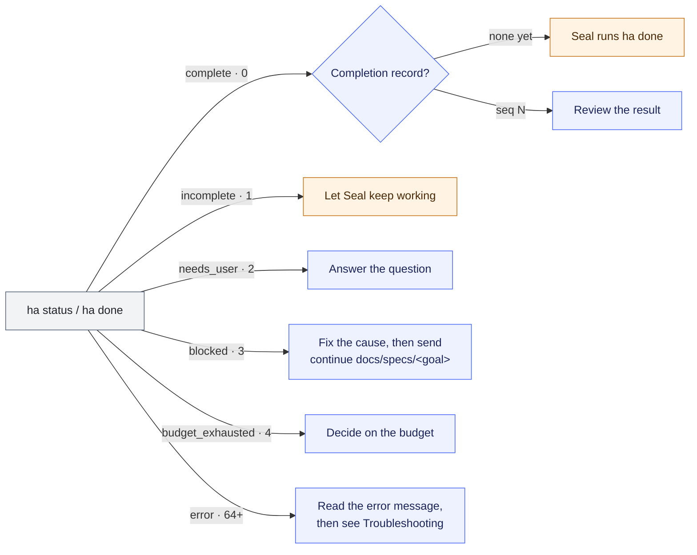

# Usage guide

[한국어](USAGE.md) · **English**

This guide follows [your first task in the README](../README.md#your-first-task). For installation, updates, and removal, see the [install guide](INSTALL.en.md).

The current release v0.1.6 combines ha 0.1.6, spec 0.1.12, seal 0.1.17 and default rules `/3`. Starting with Seal 0.1.16, Seal starts new goals under `run-rules/4`. Preflight refusal, run estimation, `/3` result classification and budget policy apply to this release. Existing goals keep their saved rules. See [Release and development combinations](INSTALL.en.md#release-and-development-combinations).

## Sending commands

Send these **in the agent conversation**, not Terminal. Replace `<request>` with the work you want and `<goal>` with the goal folder name Spec reports.

| What to do | Codex | Claude Code |
| --- | --- | --- |
| Write the goal | `$spec:spec <request>` | `/spec:spec <request>` |
| Start implementation | `$seal:seal docs/specs/<goal>` | `/seal:seal docs/specs/<goal>` |

In Codex, type `$`, select `spec:spec` or `seal:seal` installed from Jaekit, then add your request.

`@Spec` is a plugin mention. Use the skill invocation above to explicitly select Spec's instructions for writing goal documents only; a plugin mention alone does not guarantee the same instructions are selected.

The host agent can also call Spec: when you ask it to work through Jaekit or goal documents ("do this with jaekit"), or when a review finding can only be resolved by changing a requirement. Spec then writes a `Draft` document with a `Proposed-By: agent` line, or an amendment document under `amendments/`, and asks whether you accept it. The agent does not call Spec for an ordinary implementation request or bug report. Whoever called Spec, `Ready` and the start of implementation come only from your words.

<details>
<summary>Skill names and invocation prefixes</summary>

`spec:spec` means **plugin name:skill name**. This prefix is part of the plugin naming scheme, even when Jaekit is the only installation.

Codex uses `$`; Claude Code uses `/`. Short names for separately installed skills and invocation in other agents may differ.

See the [Codex plugin naming rules](https://developers.openai.com/plugins/build/plugins#create-a-plugin-manually), [Codex skill invocation example](https://learn.chatgpt.com/docs/security/plugin/code-changes#automate-reviews-in-cicd), and [Claude Code skill locations and names](https://code.claude.com/docs/en/skills#choose-where-skills-load).

</details>

## Changing a goal or continuing

Read Spec's report, then answer or ask for changes to revise the same document. Spec saves the goal, scope, and completion conditions directly to `docs/specs/<goal>/SPEC.md`, reports what it wrote and any decisions it made with their sources, then stops.

Even if you also ask it to implement the work, it only writes the goal documents. Decisions Spec proposes become yours when you accept them or ask to implement that goal.

If a goal already covers the same behavior and you have not chosen which document to write, Spec first asks whether to create a new goal or edit the existing one.

- `Status: Draft`: an outcome-changing decision remains, and Spec asks about it.
- `Status: Ready`: the document is ready. It does not start implementation by itself.
- `Assurance:`: how much independent review the implementer must get. Use `light` for small fixes, `standard` for ordinary changes, and `strict` for goals that change a public contract, stored data, permissions, or a boundary between components. Spec proposes a tier and reports why. To use another tier, say so, for example "make it strict".

When no outcome-changing decision is left, Spec ends its report with a separate question: it asks whether to implement now, naming the goal path and its tier. If you answer yes, implementation starts. If your answer also asks for a change ("yes, but drop AC-2"), Spec edits the documents first and asks again. The start command still works, and you can also tell Seal `Implement docs/specs/<goal>` instead of using the start command. You do not approve each step during the work. Answer decisions that affect the outcome and conditions that need your own confirmation.

If the conversation ends, open a new one in the same project folder and send the following. Seal reads the saved goal, plan, progress, and current state, then continues the remaining work.

```text
continue docs/specs/<goal>
```

## Reading the completion report

Start with what changed and what was verified. The report appears in the conversation and in `PROGRESS.md` in the goal folder.

- Required completion conditions need recorded checks or necessary user confirmations.
- Optional conditions do not block completion and are identified separately.
- The agent writes the automated checks.

### What to do next

Use the `ha status` / `ha done` result to find your next step. The numbers are exit codes. A `complete` from `ha status` alone is not a completion: until the output names a completion record, Seal records one with `ha done`.



Exit codes 64 and above are errors, not work statuses: 64 for a usage error, 65 for a refusal such as a goal that has not started or a broken record, 66 for a rule version the Core does not support, and 70 for an internal error. Read the message, then see [Troubleshooting](#troubleshooting).

### Completion evidence and rework

Review the assumptions, changed checks, remaining limitations, and the actual result together. The evidence of completion is the record written by `ha done`.

The assurance level `local` refers to evidence obtained on that computer. An agent with the same user permissions can change the checks and records, so it is not independent third-party verification.

The [operations guide](OPERATIONS.en.md#reading-the-completion-report) gives the detailed review procedure.

If something is missing, say what needs fixing. Seal records the rework request and continues. If the goal document itself needs changing, revise it with Spec and then separately ask to continue.

Seal's default result currently ends at local changes and commits (saved entries in the change history). You can push and create pull requests yourself or ask a general-purpose agent separately. Jaekit does not provide an independent verification environment or unattended operation.

## Saved files

Find the goal and its records in `docs/specs/<goal>/`:

| File | Written by | What it holds |
| --- | --- | --- |
| `SPEC.md` | Spec | Goal, scope, and completion conditions |
| `PLAN.md` | Seal | Plan |
| `REVIEW.md` | Seal | Plan review |
| `PROGRESS.md` | Seal | Progress and completion report |
| `runs.jsonl` | `ha` | Run record |
| `tasks/` files, when needed | Seal | Individual task descriptions |

- **Git tracking:** follow project policy. Commit these files when the project tracks them; keep them locally when the project treats them as private or ignored. Do not force ignored documents into Git.
- **Before publishing:** a commit saves history locally; publishing it is a separate step. Records can include user statements and working paths, so review them before sending them to a public repository.
- **Jaekit's policy:** this repository's own private `docs/` policy is not a requirement for other projects.
- **Raw output:** check output stays local in `.git/ha/`, which Git does not track. You do not need to add anything to `.gitignore`.
- **Linked worktrees:** in a separate working folder sharing the same Git history, output is under `ha/` in the Git directory printed by `git rev-parse --absolute-git-dir`.
- **Read output:** run `ha log <goal> <seq>` in Terminal. Here `<goal>` is the goal path, and `<seq>` is the record number from the report.
- **Run timing:** use `ha timing <goal>` to see which checks took long and how close they came to their time limit. It requires a Core with capability `run-timing/v1`; measurement details are below.
- **Decision history:** with capability `decision-history/v1`, Seal can keep summaries, evidence and correction links in the optional [decision history](../contracts/decision-history.md). Use `ha history <goal>` for current judgments, or `ha history <goal> show <event ID>` for one event's evidence and neighboring links.

<details>
<summary>Run timing: measurements and limits</summary>

For each check record, a Core that supports the time view keeps:

- The time limit it applied.
- The elapsed time of the limit interval and whether the limit fired.
- The CPU time the operating system reports.

`ha timing <goal>` shows these values as a table, and `--format json` as a `timing/v1` document. The view runs no check and does not change the record.

The limit interval runs from the limit timer's start until the process exit is confirmed or the timeout is decided. Cleanup after that is not included.

The values are measurements only: completion status and the budget do not use them. The sum of run durations adds overlapping runs, so it is not the goal's elapsed time or budget.

CPU covers different processes on each system, so do not compare it across systems as the same quantity:

| System | CPU scope |
| --- | --- |
| macOS and Linux | The process and the descendants it waited for |
| Windows | Every process in its Job Object |

CPU that was not measured shows as unavailable or failed, never as 0. Checks recorded before this feature show as not recorded.

</details>

<details>
<summary>Decision history: availability, storage, and limits</summary>

The history covers observations, causes, decisions, actions and verifications. Release v0.1.5 (`ha 0.1.5`) first provides it; v0.1.4 and earlier do not.

The history stays local under `ha/history/` in the common Git directory that every working folder of the repository shares. It does not travel to a new clone or another computer.

So `PROGRESS.md` still holds the current state, important decisions with short reasons, and how to resume without it. Recording or correcting history changes no completion, check result or budget, and the feature adds no approval step.

</details>

## Autonomy (run-rules/4)

Starting with Seal 0.1.16, Seal starts new goals with `ha start --rules run-rules/4` when the Core supports `run-rules/4` and its five features. The Core's default rule stays `run-rules/3`, and a goal that has already started keeps the rule it started with. Under the new rule, Seal does not ask again about work the authority it already has covers.

- When your request allows test changes inside the scope, Seal records its reading with `--test-authority`. When it changes or moves an existing test, it records which conditions the file checks and how with `ha note <goal> test-change`, and the change needs no confirmation. A weakening change or one outside the scope still asks for your confirmation.
- While it waits for your answer to a question, it reports the wait with `ha note <goal> wait`, and records `resume` if it continues without the answer. Only reported waits leave the budget's elapsed time.
- A run limit you approve in advance is recorded with `ha budget <goal> --preapprove`; within it, Seal raises the limit with a reason.
- When a check passed its error limit because of something Seal can fix in how it runs, such as a missing tool, Seal records `recover`. Each condition and input allows two; `allow-recovery` lets you allow more. Earlier failures stay in the record.
- A long check gets its own limit, up to two hours, in the plan's `## 시간 제한` section. When an earlier run reached or neared its limit, a notice appears before the run.

## Automatic budget

If the plan's `## 예산` gives the run count as `- 검증 실행: 자동` (automatic) instead of a number, `ha start` sets the limit. The limit is `max(50, ⌈required minimum × 1.5⌉)`: a goal with 34 required change conditions needs at least 68 runs and gets a limit of 102. You still write `경과 시간` (elapsed time) yourself. A plan with a number works as before.

When the computed limit is at or below the limit you approved in advance, the goal starts without a question. Write that pre-approved limit once in `ha.json` in your user configuration folder: `~/.config/jaekit/`, or `$XDG_CONFIG_HOME/jaekit/` when `XDG_CONFIG_HOME` is set. Without the file, the limit is 50 runs. No file inside a repository can set this limit.

```bash
mkdir -p ~/.config/jaekit
printf '{"preapproved_runs": 120}\n' > ~/.config/jaekit/ha.json
```

In Windows PowerShell:

```powershell
New-Item -ItemType Directory -Force "$HOME\.config\jaekit" | Out-Null
Set-Content -Path "$HOME\.config\jaekit\ha.json" -Value '{"preapproved_runs": 120}'
```

`ha estimate docs/specs/example` shows the same computed limit before the start, and whether your approval is needed. When the computed limit is above your limit, `ha start` records nothing and stops:

```text
ha: auto budget 102 runs (minimum 68 × 1.5, at least 50) exceeds the pre-approved limit 50 from default; the user's approval is needed: write the approved number in PLAN `검증 실행`, or have the user raise preapproved_runs in ~/.config/jaekit/ha.json
```

If you approve that count, write it as a number in the plan or raise `preapproved_runs` in `ha.json`. A malformed or unreadable file stops with `ha: pre-approved run limit: <path>: <reason>`; it is never replaced by 50. The limit applies only to the start; raising the limit and reopening after the start work as before. The exact rules are in the [run record contract](../contracts/run-record.md#13-자동-예산) (Korean).

## Troubleshooting

| Symptom | What to do |
| --- | --- |
| `ha: command not found`, or an unexpected version | Follow [Check the version](INSTALL.en.md#check-the-version) to check the installation and which executable runs |
| A skill is missing, or a short name runs another command | Reopen the agent after installation. Use the full names in the table above; in Codex, select the Jaekit skill from the `$` menu |
| Older `spec` or `seal` installations also appear | Remove the old installations using the steps below, then reopen the agent |
| `@Spec` in Codex behaves differently than expected | Select Jaekit's `spec:spec` from the `$` menu, then send your request |
| `Cannot add marketplace "jaekit"` | The name is already registered. Follow [Move from a local path registration](INSTALL.en.md#move-from-a-local-path-registration) |
| Seal stops and asks you to decide something | Answer the question. Your words are recorded before work continues. Some completion conditions may need your own confirmation |
| An expired login, denied permission, or usage limit stops the work | Resolve the cause, then send `continue docs/specs/<goal>`. The same terminal failure is not retried |
| Verification is refused because of uncommitted changes | Review the listed paths and tracked/untracked or symlink details, then resolve them according to the intended work. Unstarted checks consume no runs |
| The plan budget is too small to start | Read the minimum, limit and shortfall from `ha estimate docs/specs/<goal>`. Decide a sufficient budget or split the goal before starting; this estimate does not change an existing run budget |
| The start stops with `exceeds the pre-approved limit` | Decide whether to approve the computed count. If you do, write it as the plan's `검증 실행` number or raise `preapproved_runs` in `ha.json`. See [Automatic budget](#automatic-budget) |
| The start stops with a `pre-approved run limit` error | Read the `ha.json` path and reason it shows, then fix the file to `{"preapproved_runs": <whole number>}` or remove it |
| The budget ran out | Read what remains and decide whether to continue; see the budget details below |
| Seal stopped for Core compatibility | Read the executable it checked and the missing support. Follow [Update](INSTALL.en.md#update) to install the v0.1.6 combination, then check the capabilities of the Core actually selected. Do not bypass the check by automatically installing tools or switching rules |

<details>
<summary>Removing older installations</summary>

| Agent | List installations | Remove the old installation |
| --- | --- | --- |
| Codex | `codex plugin list` | `codex plugin remove <plugin>` |
| Claude Code | `claude plugin list` | `claude plugin uninstall <plugin>` |

Replace `<plugin>` with the old installation's ID; keep `spec@jaekit` and `seal@jaekit`. If you also copied standalone skills manually, remove their installation folders separately, then reopen the agent.

</details>

<details>
<summary>Budget changes and reopening</summary>

- `/3` can change the total run limit with your words and context, retaining usage and the time limit.
- Changing the elapsed-time limit is unsupported.
- Request an explicit reopen when a new window is needed.
- Existing `/1` or `/2` goals retain their reopen behavior with the original limits.

</details>

The [operations guide](OPERATIONS.en.md) describes the detailed reasons for user confirmation, blocked work, and budget stops. The steps above cover what you need to respond and continue.

## Verification reporting format

The reporting format introduced in Seal 0.1.10 separates these four things in the existing review and report:

- Expected-result grounds.
- Observation boundaries.
- Methods and substitutes.
- Unobserved scope.

Condition groups may share an explanation; a plan is not an observation. The current release v0.1.6 includes this format in Seal 0.1.17; existing goal formats stay unchanged.

See the [synthetic reporting example](../examples/verification-reporting.md); it is not an actual execution record.
