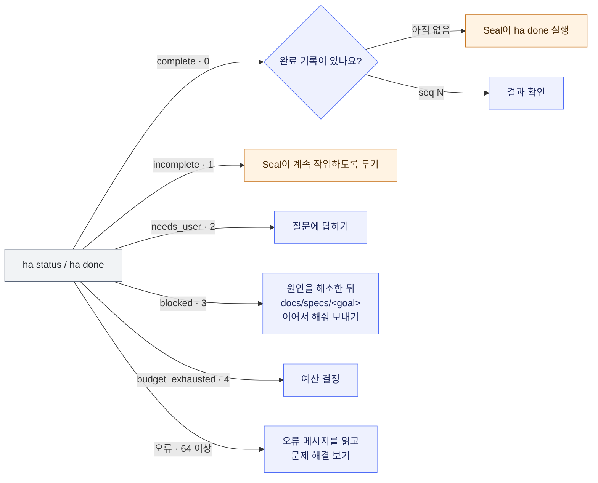

# 사용 안내

**한국어** · [English](USAGE.en.md)

[README의 첫 사용](../README.ko.md#첫-작업-맡기기) 다음에 필요한 안내입니다. 설치·업데이트·제거는 [설치 안내](INSTALL.md)에 있습니다.

현재 배포판 v0.1.7은 ha 0.1.7·spar 0.1.7·spec 0.1.13·seal 0.1.22·spar 플러그인 0.1.3 조합입니다. 기본 규칙은 `/3`이고, Seal은 0.1.16부터 새 목표를 `run-rules/4`로, 0.1.21부터 `run-rules/5`로 시작합니다. 실행 전 거부·횟수 추정, `/3` 결과 분류와 예산 정책이 적용됩니다. 기존 목표는 저장된 규칙을 유지합니다. [버전별 적용 범위](INSTALL.md#배포판과-개발-조합)를 확인합니다.

## 명령 보내기

아래 명령은 터미널이 아니라 **에이전트 대화에** 보냅니다. `<요청>`은 하고 싶은 일로, `<goal>`은 Spec이 알려 준 목표 폴더 이름으로 바꿉니다.

| 할 일 | Codex | Claude Code |
| --- | --- | --- |
| 목표 문서 작성 | `$spec:spec <요청>` | `/spec:spec <요청>` |
| 구현 시작 | `$seal:seal docs/specs/<goal>` | `/seal:seal docs/specs/<goal>` |

Codex에서는 `$`를 입력하고 Jaekit에서 설치한 `spec:spec` 또는 `seal:seal`을 고른 뒤 요청을 이어 씁니다.

`@Spec`은 플러그인 언급입니다. 목표 문서만 쓰는 Spec의 지침을 명확히 선택하려면 위의 스킬 호출을 사용합니다. 플러그인 언급만으로 같은 지침이 선택된다는 보장이 없습니다.

에이전트도 Spec을 부를 수 있습니다. "이거 jaekit으로 해줘"처럼 Jaekit이나 목표 문서로 일하자고 할 때와, 검토 지적이 요구사항을 바꿔야만 풀릴 때입니다. 이때 Spec은 `Proposed-By: agent` 줄이 있는 `Draft` 문서나 `amendments/` 아래의 수정안 문서를 쓰고 받아들일지 묻습니다. 평범한 구현 요청이나 버그 제보에는 부르지 않습니다. 누가 불렀든 `Ready`와 구현 시작은 사용자의 말로만 일어납니다.

<details>
<summary>스킬 이름과 호출 접두사</summary>

`spec:spec`은 **플러그인 이름:스킬 이름**입니다. 예전 설치본과 이름이 겹쳐서 붙는 접두사가 아니며, Jaekit만 설치했어도 이 이름을 사용합니다.

Codex는 `$`, Claude Code는 `/`로 호출합니다. 직접 설치한 단독 스킬의 짧은 이름이나 다른 에이전트의 호출법까지 같다고 가정하지 않습니다.

[Codex 플러그인 이름 규칙](https://developers.openai.com/plugins/build/plugins#create-a-plugin-manually), [Codex의 스킬 호출 예시](https://learn.chatgpt.com/docs/security/plugin/code-changes#automate-reviews-in-cicd), [Claude Code 스킬 위치와 이름](https://code.claude.com/docs/en/skills#choose-where-skills-load)을 참고하세요.

</details>

## 목표를 고치거나 이어 가기

보고를 읽고 답하거나 수정을 요청하면 같은 문서를 고칩니다. Spec은 목표와 범위, 완료 조건을 `docs/specs/<goal>/SPEC.md`에 바로 저장하고, 쓴 내용과 스스로 정한 결정·출처를 보고한 뒤 멈춥니다.

"구현까지 해줘"라고 함께 말해도 목표 문서만 씁니다. Spec이 제안한 결정은 사용자가 받아들이거나 그 목표의 구현을 요청하면 사용자의 결정이 됩니다.

같은 동작을 다루는 목표가 이미 있는데 작성 대상을 정하지 않았다면, Spec은 새 목표로 쓸지 기존 목표를 고칠지 먼저 묻습니다.

- `Status: Draft`: 결과를 바꾸는 결정이 남아 있으며 Spec이 질문합니다.
- `Status: Ready`: 문서가 준비됐다는 표시입니다. 그 자체로 구현을 시작하지 않습니다.
- `Assurance:`: 구현 담당이 받아야 하는 독립 검토의 정도입니다. `light`는 작은 수정, `standard`는 보통의 변경, `strict`는 공개 계약·저장 데이터·권한·구성 요소 사이 경계를 바꾸는 목표에 씁니다. Spec이 등급을 제안하고 이유를 보고합니다. 다른 등급을 원하면 "strict로 해줘"처럼 말합니다.

결과를 바꾸는 결정이 남지 않으면 Spec은 보고 끝에 지금 구현할지 따로 묻고 목표 경로와 등급을 함께 알립니다. 그 질문에 "응"이라고 답하면 구현이 시작됩니다. 답에 수정 요청을 함께 적으면("응, 그런데 AC-2는 빼줘") Spec이 먼저 문서를 고치고 다시 묻습니다. 구현 시작 명령도 계속 쓸 수 있습니다. Seal에는 시작 명령 대신 `docs/specs/<goal> 구현해줘`라고 말해도 됩니다. 작업 중에는 매 단계 승인하지 않고, 결과를 바꾸는 결정이나 사람이 직접 확인해야 하는 항목에 답합니다.

대화가 끊겼다면 같은 프로젝트 폴더의 새 대화에서 다음과 같이 보냅니다. Seal이 저장된 목표·계획·진행 기록과 현재 상태를 확인하고 남은 일을 이어 갑니다.

```text
docs/specs/<goal> 이어서 해줘
```

## 완료 보고 읽기

먼저 바뀐 결과와 무엇을 확인했는지 읽습니다. 완료 보고는 대화와 목표 폴더의 `PROGRESS.md`에 남습니다.

- 필수 완료 조건은 검사 기록 또는 필요한 사용자 확인으로 충족돼야 합니다.
- 선택 조건은 완료를 막지 않으며 보고에서 구분합니다.
- 자동 검사는 에이전트가 작성합니다.

### 결과에 따라 할 일

`ha status` / `ha done`의 결과에 따라 다음에 할 일을 확인합니다. 숫자는 종료 코드입니다. `ha status`의 `complete`만으로는 완료가 아닙니다. 출력에 완료 기록이 나오기 전까지는 Seal이 `ha done`으로 완료를 기록합니다.



64 이상은 작업 상태가 아니라 오류입니다. 64는 사용법 오류, 65는 시작하지 않은 목표나 끊긴 기록 같은 거절, 66은 Core가 지원하지 않는 규칙 버전, 70은 내부 오류입니다. 메시지를 읽고 [문제 해결](#문제-해결)을 봅니다.

### 완료 근거와 재작업

가정, 바뀐 검사, 남은 한계와 실제 결과를 함께 확인합니다. 완료의 근거는 `ha done`이 남긴 완료 기록입니다.

보증 수준 `local`은 그 컴퓨터에서 얻은 근거라는 뜻입니다. 같은 사용자 권한의 에이전트가 검사와 기록을 바꿀 수 있으므로 독립된 제3자의 검증을 뜻하지 않습니다.

자세한 확인 순서는 [운영 안내](OPERATIONS.md#완료-보고-읽기)에 있습니다.

빠진 것이 있으면 무엇을 고칠지 말합니다. Seal이 재작업 요청을 기록하고 다시 진행합니다. 목표 문서부터 바꿔야 한다면 Spec으로 고친 뒤, 별도로 계속하라고 요청합니다.

현재 Seal의 기본 결과는 로컬 변경과 commit(변경 이력을 저장한 단위)까지입니다. push·PR은 사용자가 직접 하거나 일반 에이전트에 별도로 요청할 수 있습니다. Jaekit은 독립된 검증 환경이나 무인 운영 기능을 제공하지 않습니다.

## 저장되는 파일

목표와 기록은 `docs/specs/<goal>/`에서 확인합니다.

| 파일 | 작성 주체 | 담는 내용 |
| --- | --- | --- |
| `SPEC.md` | Spec | 목표, 범위, 완료 조건 |
| `PLAN.md` | Seal | 계획 |
| `REVIEW.md` | Seal | 계획 검토 |
| `PROGRESS.md` | Seal | 진행·완료 보고 |
| `runs.jsonl` | `ha` | 실행 기록 |
| 필요한 `tasks/` 파일 | Seal | 작업별 설명 |

- **Git 추적:** 프로젝트 정책에 따릅니다. 추적하는 프로젝트에서는 commit합니다. 비공개·ignore 정책이면 로컬에 보관하고 강제로 Git에 추가하지 않습니다.
- **공개 전송 전:** commit은 로컬 이력 저장이며 공개 전송은 별도입니다. 기록에는 사용자 발화와 작업 경로가 들어갈 수 있으므로 공개 저장소에 보내기 전에 내용을 확인합니다.
- **Jaekit의 정책:** 이 저장소 자체의 비공개 `docs/` 정책은 다른 프로젝트의 필수 설정이 아닙니다.
- **출력 원문:** 검사 출력은 로컬에만 있으며 Git이 추적하지 않는 `.git/ha/`에 남습니다. `.gitignore`에 더할 것은 없습니다.
- **Linked worktree:** Git 이력을 공유하는 별도 작업 폴더에서는 `git rev-parse --absolute-git-dir`이 알려 주는 Git 폴더 아래 `ha/`에 출력이 있습니다.
- **출력 확인:** 터미널에서 `ha log <goal> <seq>`를 실행합니다. 여기서 `<goal>`은 목표 경로, `<seq>`는 보고에 나온 기록 번호입니다.
- **실행 시간:** `ha timing <goal>`로 어느 검사가 오래 걸렸는지, 시간 제한에 얼마나 가까웠는지 봅니다. 시간 보기(capability `run-timing/v1`)를 지원하는 Core가 필요하며 측정 세부 사항은 아래에 있습니다.
- **판단 이력:** 지원 정보 `decision-history/v1`이 있으면 Seal이 선택 기능인 [판단 이력](../contracts/decision-history.md)에 요약과 근거, 정정 관계를 남길 수 있습니다. 현재 판단은 `ha history <goal>`, 한 사건의 근거와 앞뒤 관계는 `ha history <goal> show <사건 ID>`로 읽습니다.

<details>
<summary>실행 시간: 측정값과 한계</summary>

시간 보기를 지원하는 Core는 검사 기록마다 다음을 남깁니다.

- 적용한 시간 제한.
- 제한 구간 경과와 제한 발동 여부.
- 운영체제가 주는 CPU 시간.

`ha timing <goal>`은 이 값을 표로, `--format json`은 `timing/v1` 문서로 보여 줍니다. 보기는 검사를 실행하지 않고 기록을 바꾸지 않습니다.

제한 구간은 제한 타이머가 켜진 때부터 프로세스 종료를 확인했거나 시간 초과를 결정한 때까지입니다. 그 뒤의 정리 시간은 들어가지 않습니다.

이 값은 측정값일 뿐 완료 판정과 예산에는 쓰이지 않습니다. 실행 시간의 합은 겹친 실행을 더한 값이라 목표 경과 시간이나 예산이 아닙니다.

CPU는 운영체제마다 세는 범위가 달라 운영체제 사이에 같은 뜻으로 비교하지 않습니다.

| 운영체제 | CPU 범위 |
| --- | --- |
| macOS·Linux | 실행한 프로세스와 그것이 기다린 하위 프로세스 |
| Windows | Job Object 안의 모든 프로세스 |

측정하지 못한 CPU는 0이 아니라 측정 불가나 측정 실패로 보입니다. 이 기능 전에 기록한 검사는 "기록되지 않음"으로 보입니다.

</details>

<details>
<summary>판단 이력: 지원 버전, 저장 위치와 한계</summary>

이력은 관측·원인·결정·조치·검증을 다룹니다. 배포판 v0.1.5(`ha 0.1.5`)부터 이 기능이 있으며, v0.1.4 이하에는 없습니다.

이력은 같은 저장소의 모든 작업 폴더가 공유하는 공통 Git 폴더의 `ha/history/`에 로컬로만 있습니다. 새 clone이나 다른 컴퓨터에는 따라가지 않습니다.

그래서 `PROGRESS.md`는 이력 없이도 현재 상태, 중요한 결정과 짧은 이유, 재개 방법을 담습니다. 이력을 쓰거나 고쳐도 완료, 검사 결과, 예산은 바뀌지 않으며 이 기능만의 승인 단계도 없습니다.

</details>

## 자율 처리 (run-rules/4)

Seal 0.1.16부터 Core가 `run-rules/4`와 그 다섯 기능을 지원하면 새 목표를 `ha start --rules run-rules/4`로 시작합니다. Core의 기본 규칙은 그대로 `run-rules/3`이고, 이미 시작한 목표는 시작할 때의 규칙으로 계속 계산합니다. 새 규칙에서 Seal은 이미 받은 권한 안의 일을 다시 묻지 않습니다.

- 요청이 범위 안의 시험 변경을 허용하면 `--test-authority`로 그 해석을 남깁니다. 기존 시험을 고치거나 옮길 때는 `ha note <goal> test-change`로 어느 조건을 어떻게 확인하는지 남기고, 그러면 사용자 확인이 필요 없습니다. 약화하는 변경과 범위 밖의 변경은 지금처럼 확인을 묻습니다.
- 질문하고 답을 기다리는 동안은 `ha note <goal> wait`로 신고하고, 답 없이 계속하면 `resume`을 남깁니다. 신고한 대기만 예산의 경과 시간에서 빠집니다.
- 실행 상한을 미리 허락하면 `ha budget <goal> --preapprove`로 기록되고, 그 안에서는 Seal이 이유만으로 상한을 올립니다.
- 도구 설치처럼 실행 조건을 고쳐 오류 한도를 넘은 검사를 다시 볼 수 있으면 `recover`를 남깁니다. 조건·입력마다 두 번이며, 더 허락하려면 `allow-recovery`를 씁니다. 이전 실패는 그대로 남습니다.
- 오래 걸리는 검사는 PLAN의 `## 시간 제한` 절에 2시간까지 제한을 정합니다. 이전 실행이 제한에 걸렸거나 가까웠으면 실행 전에 안내가 나옵니다.

## 사람용 보고와 도구 점검

`ha report <goal>`은 목표의 상태를 다섯 줄로 요약합니다. 기본은 영어이고 `--lang ko`를 붙이면 한국어로 나옵니다. `ha status`와 같은 계산을 읽기만 하며 기록을 바꾸지 않습니다.

| 표지 | 읽는 것 |
| --- | --- |
| `바뀐 것` | 시작 이후 실행 묶음 문서 밖에서 바뀐 파일과 commit 수 |
| `확인한 것` | 충족한 필수 조건 수(검사 기록과 사용자 확인)와 수정 전 실패를 확인한 change 조건 수 |
| `직접 볼 것` | 사용자가 정할 것, 인용으로 확인한 조건, 근거만으로 면제된 시험 변경, 바뀐 검증 명령처럼 사람이 봐야 할 항목 |
| `남은 한계` | 보증 수준 `local`, 검사 작성자, 충족되지 않은 선택 조건, 예산 초과, 지금 HEAD를 덮는 완료 기록이 없는지 |
| `다음 행동` | 지금 상태에서 할 일 하나 |

base commit이 없는 얕은 clone처럼 Git이 base와 HEAD를 비교할 수 없으면 다섯 줄만 보이고 70으로 끝납니다. 이때 `다음 행동`이 base를 받는 방법(예: `git fetch --unshallow`)을 알립니다.

요약 뒤에는 `PROGRESS.md`의 `## 현재`에 옮겨 적을 도장(기록 head의 seq·hash, 기록 시각, 상태), 조건별 근거, 완료 범위, 충족되지 않은 조건의 원문 위치(`ha log <goal> <seq>`)가 이어집니다. 합성 예시:

```text
바뀐 것: base 3c1f0a9e7b25 이후 실행 묶음 문서 밖에서 파일 2개, commit 2개
확인한 것: 필수 조건 2개 중 2개 충족(검사 기록 2개, 사용자 확인 0개); change 조건 1개 중 1개에 신선한 baseline
직접 볼 것: 없음
남은 한계: 보증 수준 local; 검사 작성자: 실행자
다음 행동: 없음; 완료 기록 seq 5이 유효하고 남은 할 일이 없음
```

검사에 필요한 도구를 미리 확인하려면 PLAN에 `## 실행 환경` 절을 두고 한 줄에 도구 하나씩 `` - <이름>: `<점검 명령>` `` 형식으로 씁니다.

```markdown
## 실행 환경
- 브라우저: `node scripts/probe-browser.mjs`
- 셸: `sh tests/env/plain.sh`
```

`ha doctor <goal>`은 이 점검 명령을 차례로 60초 제한으로 실행하고 도구마다 `사용 가능` 또는 `사용 불가 (<이유>)`를 보입니다. 사용 불가면 그 출력의 끝부분이 아래에 나옵니다. 시작 전에도 쓸 수 있고 기록·실행 횟수에는 아무것도 남지 않습니다. 형식이 틀린 줄은 파일과 줄을 알리고 아무 점검도 실행하지 않습니다. 이 절은 판정에 쓰이지 않습니다.

## 자동 예산

PLAN의 `## 예산`에 횟수를 숫자 대신 `- 검증 실행: 자동`으로 쓰면 `ha start`가 상한을 정합니다. 상한은 `max(50, ⌈필수 최소량 × 1.5⌉)`입니다. 필수 change가 34개인 목표는 최소량 68회, 상한 102회입니다. `경과 시간`은 지금처럼 직접 씁니다. 숫자를 쓴 PLAN은 지금과 같습니다.

산정한 상한이 미리 승인한 상한 이하이면 묻지 않고 시작합니다. 미리 승인한 상한은 사용자 설정 폴더의 `ha.json`에 한 번 적어 둡니다. 폴더는 `~/.config/jaekit/`이고, `XDG_CONFIG_HOME`이 설정되어 있으면 `$XDG_CONFIG_HOME/jaekit/`입니다. 파일이 없으면 상한은 50회입니다. 저장소 안의 파일은 이 상한을 정하지 못합니다. 이를 확인하려고 파일이 있으면 `git worktree list -z`로 작업 트리를 읽으므로 Git 2.36 이상이 필요합니다.

```bash
folder="${XDG_CONFIG_HOME:-$HOME/.config}/jaekit"
mkdir -p "$folder"
printf '{"preapproved_runs": 120}\n' > "$folder/ha.json"
```

홈은 환경 변수 `HOME`이 있으면 그 값이고, 없으면 Windows에서는 `USERPROFILE`입니다. Windows PowerShell에서는 같은 순서로 폴더를 골라 씁니다.

```powershell
$folder = if ($env:XDG_CONFIG_HOME) { "$env:XDG_CONFIG_HOME\jaekit" } elseif ($env:HOME) { "$env:HOME\.config\jaekit" } else { "$env:USERPROFILE\.config\jaekit" }
New-Item -ItemType Directory -Force $folder | Out-Null
Set-Content -Path "$folder\ha.json" -Value '{"preapproved_runs": 120}'
```

`ha estimate docs/specs/example`이 시작 전에 같은 산정 값과 승인이 필요한지를 보입니다. 산정 값이 상한을 넘으면 `ha start`는 기록을 남기지 않고 다음처럼 멈춥니다.

```text
ha: auto budget 102 runs (minimum 68 × 1.5, at least 50) exceeds the pre-approved limit 50 from default; the user's approval is needed: write the approved number in PLAN `검증 실행`, or have the user raise preapproved_runs in ~/.config/jaekit/ha.json
```

이때 사용자가 그 횟수를 승인하면 PLAN에 숫자로 적거나 `ha.json`의 `preapproved_runs`를 올립니다. 파일 형식이 틀렸거나 읽을 수 없으면 `ha: pre-approved run limit: <경로>: <이유>`로 멈추며 50회로 대신하지 않습니다. 이 상한은 시작할 때만 쓰입니다. 시작 뒤의 증액·재개 규칙은 그대로입니다. 정확한 규칙은 [실행 기록 계약](../contracts/run-record.md#15-자동-예산)에 있습니다.

## Seal의 시작 전 확인과 검토 순서

Seal 0.1.20은 Core에 필요한 지원을 skill 폴더의 `core-requirements.json`에 선언하고 `ha start --check-skill`로 시작합니다. 실행 파일에 `ha report`, `ha doctor`, 자동 예산, 등급 줄 검증 같은 지원이 없으면 `ha`가 기록 없이 시작을 거부하고, Seal은 실행 파일과 메시지를 알리고 멈춥니다. 도구를 설치하거나 이전 규칙으로 돌아가지 않습니다. v0.1.7의 `ha`는 이 지원을 모두 갖췄습니다. v0.1.6 이하의 `ha`는 이 시작을 받지 않습니다.

- **예산 질문은 한 번.** 요청에 예산이 없으면 Seal이 PLAN에 `검증 실행: 자동`을 씁니다. 산정 값이 미리 승인한 상한 안이면 묻지 않고 시작하고, 넘으면 산정 값과 상한을 보이며 한 번 묻습니다. 답한 숫자가 PLAN에 들어가고, 같은 PLAN에 같은 질문을 다시 하지 않습니다. Seal은 `ha.json`을 쓰거나 고치지 않습니다.
- **시작 전 환경 점검.** 검사가 브라우저·DB·컨테이너·외부 서비스를 쓰면 Seal이 PLAN의 `## 실행 환경`에 적고, baseline을 기록하기 전과 재개 뒤 첫 검사 전에 `ha doctor`를 돌립니다. 사용 불가인 도구는 한 질문으로 모아 묻고, 권한이나 설정을 스스로 넓히지 않습니다.
- **시작 전 질문은 한 메시지로.** Seal 0.1.23부터는 baseline을 기록하기 전에, 목표 문서·계획·프로젝트 지침·코드를 읽어 미리 알 수 있고 사용자의 말이 필요한 결정을 모아 한 메시지로 묻습니다. 보호 경로의 파일을 바꾸는 계획, 요청이 허락하지 않은 기존 시험의 변경, 목표 문서와 코드가 어긋나 보이는 곳, 쓸 수 없는 도구, 승인이 필요한 예산이 그런 예입니다. 질문마다 추천을 앞에 둔 선택지와 답이 바꾸는 것을 밝힙니다. 사용자 확인으로만 충족할 조건이 있으면 그 조건과 끝에 무엇을 확인해 달라고 할지도 같은 메시지에서 알립니다. 물을 것이 없으면 아무것도 묻지 않고 바로 일합니다. 계획이 새로 만들 시험·검사 파일은 처음부터 `바꿀 수 있는 경로`에 들어가므로 나중에 범위 확인을 묻지 않습니다.
- **시작 뒤 질문은 생길 때.** 검토에서 나온 `requirement-question`이나 라운드 상한처럼 미리 알 수 없던 질문은 생겼을 때 묻고, 같은 때 기다리는 질문은 한 메시지로 묻습니다. 끝에 필요한 사용자 확인도 결과가 생긴 뒤 한 메시지로 모아 묻습니다. 권한 밖의 변경이나 검사를 약하게 하는 변경은 미리 물었다는 것만으로 확인되지 않습니다. 미리 받은 답은 그 답이 허락한 변경을 commit한 뒤 그 답을 인용해 확인으로 기록하고, 그 변경을 다시 묻지 않습니다. 확인한 내용이 그 뒤 다시 바뀌면 새 변경이라 다시 묻습니다.
- **다섯 줄 보고.** 0.1.20 이상으로 시작한 목표의 `PROGRESS.md`는 `ha report`를 씁니다. `## 현재` 맨 위에는 `ha report`의 도장이 그대로 들어가고, Seal이 시각을 손으로 적지 않습니다. `## 완료 보고`는 맨 위 다섯 줄(`바뀐 것`, `확인한 것`, `직접 볼 것`, `남은 한계`, `다음 행동`)을 먼저 읽고, 그 아래에서 완료 기록과 Seal의 판단 문장을 봅니다. 한국어로 요청하면 `--lang ko`로 만듭니다.

SPEC의 `Assurance:` 줄에 따라 독립 검토 단계가 정해집니다. 검토의 방법은 Spar가, 시점과 지적 처리는 Seal이 정합니다.

| 등급 | 받는 검토 |
| --- | --- |
| `light` | 독립 검토를 생략할 수 있고, 생략하면 이유를 `REVIEW.md`와 완료 보고에 남깁니다 |
| `standard` | 최종 후보의 candidate 라운드, 검토 수정 뒤 fixes 라운드, `ha done` 전 누적 라운드 |
| `strict` | `standard`에 더해 baseline 전 plan 라운드. 검사 계획만이 아니라 제품의 불변식과 결정 규칙도 봅니다 |

누적 라운드는 목표의 base commit부터 마지막 head까지 전체를 다시 보는 candidate 라운드입니다. 독립 검토를 받는 목표에서 Seal은 이 라운드가 열린 `defect`·`requirement-question` 없이 끝난 뒤에만 `ha done`을 실행합니다. 프로젝트 지침(`AGENTS.md` 등)이 더 많은 검토를 요구하면 그쪽을 따르고 완료 보고에 적습니다. 줄이 없는 목표는 이전처럼 선택된 보증 정책을 따릅니다. 완료 뒤 원격 리뷰를 반영해 달라고 하면 `reopen`, 수정, 누적 라운드, 낡은 검사의 재기록, `ha done` 순으로 진행합니다.

Seal skill 본문은 약 4,600단어에서 2,200단어 이하로 줄었습니다. Seal 0.1.23은 시작 전 질문 규칙을 더하면서 상한을 2,300단어로 올렸습니다. 이전 Seal로 시작한 목표의 형식은 그런 목표를 이어 갈 때만 읽는 참고 문서(`references/earlier-goals.md`)로 옮겼고, 그 목표의 기록과 문서는 바꾸지 않습니다.

## 검토 gate (run-rules/5)

v0.1.7부터 Seal(0.1.21 이상)은 새 목표를 `ha start --rules run-rules/5`로 시작합니다. `run-rules/5`는 `run-rules/4`의 자율 처리를 모두 그대로 두고, SPEC의 등급이 `standard`나 `strict`인 목표에 독립 검토의 기록을 완료 조건으로 더합니다. 그래서 `run-rules/5`로 시작한 `standard`·`strict` 목표는 기록된 Spar gate가 있어야 완료됩니다. `light` 목표, `Assurance:` 줄이 없는 목표, `run-rules/4` 이하로 시작한 목표에는 Spar가 필요 없습니다. 검토 없이 끝내려면 등급을 `light`로 낮추는 목표 문서 수정을 사용자가 정합니다(아래 목록).

설치된 `ha`가 `run-rules/5`나 Seal이 요구하는 다른 지원을 모르면, Seal은 기록 없이 멈추고 이전 규칙으로 물러나지 않습니다. 할 일은 그 지원을 갖춘 `ha`를 설치하는 것입니다.

- 누적 라운드가 열린 지적 없이 끝나면 Seal이 그 series의 라운드로 `spar gate`를 HEAD에 대해 만들고, `ha note <goal> review --gate <file>`로 gate 파일을 기록한 다음 `ha done`을 실행합니다. 기록에는 파일 digest와 판정에 필요한 요약만 남고 지적 원문은 남지 않습니다.
- gate가 없으면 `review_missing`, 검토 뒤 commit이 더 있으면 `review_head_stale`, 검토 뒤 목표 문서가 바뀌었거나 라운드가 목표 문서를 모두 받지 않았으면 `review_docs_stale`이 나오고 완료가 기록되지 않습니다. gate가 `blocked`·`degraded`이거나 열린 `defect`·`requirement-question`이 있을 때, code 라운드가 없을 때, `strict`인데 plan 라운드가 없을 때도 각자의 이유가 나옵니다. 사용자 확인이나 다른 note는 gate를 대신하지 않습니다.
- Spar를 쓸 수 없어 검토 없이 끝내려면, 사용자가 SPEC을 `Assurance: light`로 낮추는 수정을 정합니다. 그 뒤 `confirm spec`과 신선한 검사로 gate 없이 완료됩니다.
- `light`이거나 등급 줄이 없는 목표, 그리고 `run-rules/1`~`run-rules/4`로 시작한 목표는 지금처럼 gate 없이 판정합니다.

## 목표 하나의 비용 보기

`ha cost <goal>`은 목표 하나가 검증과 검토에 들인 비용을 한 화면에 모읍니다. 기록을 읽기만 하고 아무것도 쓰지 않으며, 현재 시각을 읽지 않고 모델을 부르지 않습니다. Spar 검토 기록은 `--series`로 그 목표의 series 폴더를 가리킬 때만 읽습니다. 위치를 짐작하지 않으므로 series가 여럿이면 `--series`를 여러 번 씁니다.

```bash
ha cost docs/specs/<goal> --series docs/reviews/<goal>
```

- **종류와 크기:** 등급, 규칙 버전, 필수·선택 조건 수, base 이후 바뀐 파일과 commit 수(`ha report`의 `Changed`와 같음), 유효한 완료 기록.
- **검증:** 실행 수와 시간, 조건별 실행 수, 다시 기록한 실행마다 앞 기록과 달라진 입력(코드, 목표 문서, 검증 명령, 덧씌운 검사 파일). 달라진 입력이 없으면 앞 기록의 결과를 보입니다. 예산 창의 값은 `ha status`와 같습니다.
- **질문과 대기:** 신고한 대기마다 물은 결정과 길이, Spar의 `requirement-question`과 그 답, 상한 연장, 리뷰어 waiver. 출처별로 세고 나열만 합니다. 범위·권한 결정인지 불필요한 재확인인지는 목록을 읽는 사람이 판단합니다.
- **검토 라운드와 지적:** 단계별 라운드 수(상한에 센 라운드와 재실행), 리뷰어 시간, 분류·위치별 지적과 처리, fixes 라운드가 더한 줄(gate의 `growth`). `--series`가 없으면 주지 않았다고 보이고 0으로 보이지 않습니다.
- **토큰:** 어느 기록에도 없어 "기록 없음"으로 보입니다.

`--format json`은 같은 값을 `cost/v1` 문서로 보이고, `--lang ko`는 표지와 문장만 바꿉니다. 형식과 각 값의 출처는 [실행 기록 계약](../contracts/run-record.md) §1.7에 있습니다.

**견줄 때.** 요약은 숫자만 보이고 다른 목표와 비교하거나 나아졌다고 말하지 않습니다. 목표끼리 견줄 때는 같은 등급, 비슷한 크기(조건 수, 바뀐 파일과 commit 수)의 목표를 나란히 놓으세요. 과정을 바꾸기 전과 뒤의 목표 몇 개를 견준 차이에는 목표마다 다른 내용과 우연이 섞여 있어, 그 차이는 바꾼 과정의 인과 효과가 아닙니다.

## 문제 해결

| 증상 | 할 일 |
| --- | --- |
| `ha: command not found` 또는 기대한 버전이 아니다 | [버전 확인](INSTALL.md#버전-확인)에서 설치 여부와 실제 실행 파일을 확인합니다 |
| 스킬이 안 보이거나 짧은 이름이 다른 명령을 실행한다 | 설치 후 에이전트를 새로 엽니다. 위 표의 전체 이름을 쓰고, Codex에서는 `$` 목록에서 Jaekit의 스킬을 고릅니다 |
| 예전 `spec`·`seal` 설치본이 함께 보인다 | 아래 절차로 이전 설치본을 제거하고 에이전트를 새로 엽니다 |
| Codex의 `@Spec`이 기대와 다르게 동작한다 | `$` 목록에서 Jaekit의 `spec:spec`을 고르고 요청을 보냅니다 |
| `Cannot add marketplace "jaekit"` 오류가 난다 | 같은 이름이 이미 등록되어 있습니다. [로컬 경로 등록에서 옮기기](INSTALL.md#로컬-경로-등록에서-옮기기)를 따릅니다 |
| Seal이 멈추고 정할 것을 묻는다 | 질문에 답합니다. 답을 인용해 기록한 뒤 이어 갑니다. 직접 확인해야 하는 완료 조건도 있을 수 있습니다 |
| 인증 만료·권한 거부·사용량 한도로 멈췄다 | 원인을 해소한 뒤 `docs/specs/<goal> 이어서 해줘`라고 보냅니다. 같은 실패를 반복하지 않습니다 |
| 검사 전에 미커밋 변경 때문에 거부됐다 | 출력된 경로와 tracked/untracked·symlink 표시를 확인하고 작업 의도에 따라 정리합니다. 실행하지 않은 검사는 횟수에 들어가지 않습니다. [실행 전 안내](OPERATIONS.md#실행-전에-확인할-것)를 참고합니다 |
| 시작 전에 검증 예산이 부족하다고 나온다 | `ha estimate docs/specs/<goal>`의 최소량·상한·부족량을 확인합니다. 시작 전에 충분한 예산이나 목표 분할을 결정합니다 |
| 시작이 `exceeds the pre-approved limit`로 멈췄다 | 산정한 횟수를 승인할지 정합니다. 승인하면 그 숫자를 PLAN `검증 실행`에 쓰거나 `ha.json`의 `preapproved_runs`를 올립니다. [자동 예산](#자동-예산)을 봅니다 |
| `pre-approved run limit` 오류로 멈췄다 | 출력된 `ha.json` 경로와 이유를 보고 파일을 `{"preapproved_runs": <정수>}` 형식으로 고치거나 지웁니다 |
| 예산을 다 썼다며 멈췄다 | 남은 일을 읽고 계속할지 정합니다. 아래 예산 세부 사항을 참고합니다 |
| Seal이 Core 호환성 때문에 멈췄다 | 확인한 실행 파일과 부족한 지원을 읽습니다. [업데이트 안내](INSTALL.md#업데이트)에 따라 v0.1.7 조합을 설치한 뒤 실제 선택된 Core의 지원 정보를 다시 확인합니다. 자동 설치나 구규칙 전환으로 우회하지 않습니다 |

<details>
<summary>이전 설치본 제거</summary>

| 에이전트 | 설치 목록 확인 | 이전 설치본 제거 |
| --- | --- | --- |
| Codex | `codex plugin list` | `codex plugin remove <plugin>` |
| Claude Code | `claude plugin list` | `claude plugin uninstall <plugin>` |

`<plugin>`에는 이전 설치본의 ID를 넣고, `spec@jaekit`·`seal@jaekit`은 유지합니다. 직접 복사한 스킬도 있다면 해당 설치 폴더를 별도로 정리하고 에이전트를 새로 엽니다.

</details>

<details>
<summary>예산 변경과 재개</summary>

- `/3`은 사용자 동의와 문맥을 기록해 횟수 총상한을 바꾸며 쓴 횟수·시간 한도를 유지합니다.
- 시간 상한 변경은 지원하지 않습니다.
- 새 창이 필요하면 명시적 재개를 요청합니다.
- 기존 `/1`·`/2`는 원래 한도의 새 창을 여는 재개 규칙을 유지합니다.

</details>

판단 이유와 재개 규칙은 [운영 안내](OPERATIONS.md)의 사용자 확인 및 막힘·예산 절에서 자세히 설명합니다.

## 검증 보고 형식

Seal 0.1.10부터 도입된 보고 형식은 기존 검토·보고에서 다음 네 가지를 구분합니다.

- 기대 결과의 근거.
- 관측 경계.
- 시험 방법·대체 환경.
- 미확인 범위.

조건 그룹이 같은 설명을 참조할 수 있으며, 실제 수행과 예정은 다릅니다. 현재 배포판 v0.1.7의 Seal 0.1.22에도 포함되며 기존 목표 형식은 유지합니다.

[자세한 보고 경계](OPERATIONS.md#검증-근거-보고)를 참고하세요.
